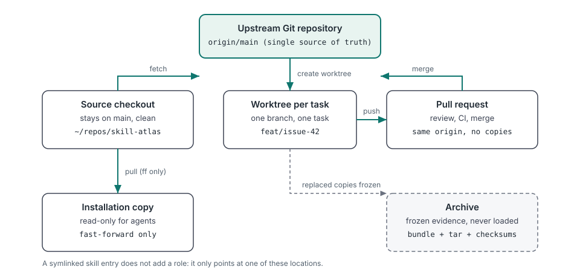
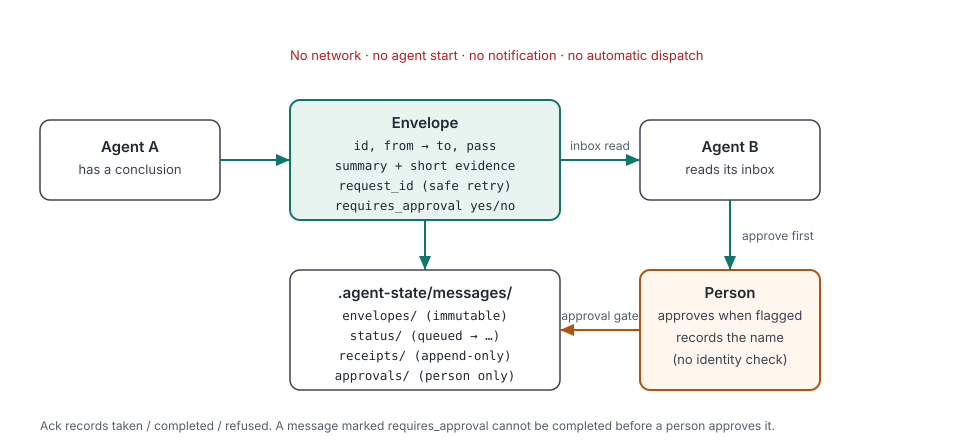
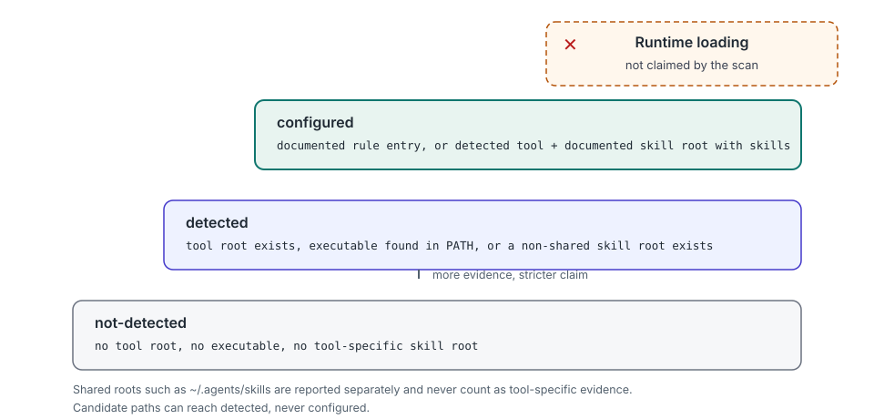

# Skill Atlas

**English** · [简体中文](README.zh-CN.md) · [Русский](README.ru.md)

Website: [jorgut.github.io/skill-atlas](https://jorgut.github.io/skill-atlas/)

**The local agent environment atlas** — what your agents see, what they load, where copies diverge.

[](https://skills.sh/Jorgut/skill-atlas)
[](https://github.com/Jorgut/skill-atlas)


Your machine has coding agents. Skill Atlas tells you which ones exist, where they load rules and skills from, whether your Skill Atlas copies disagree, and where project copies have drifted — read-only by default.

It is a local-aware, cross-platform manager for agent skills. It inventories installed skills, detects duplicates and symlinks, plans updates and consolidation, discovers alternatives and competitors, recommends skill stacks for products and professional workflows, validates multi-skill orchestration, guides shared project context and handoff across agent tools, reports read-only local evidence about installed coding-agent tools and project copies, and can relay compact cross-agent handoff messages through local files.

It supports Codex, OpenCode, Claude Code, shared `~/.agents/skills` installations, plugin caches, and custom skill roots. Its agent-led collaboration workflow also covers DeepSeek Harness and other tools after verifying their instruction-loading support. Read-only planning is the default.

Beginner guides: [中文](docs/GETTING_STARTED.zh-CN.md) | [English](docs/GETTING_STARTED.en.md) | [Русский](docs/GETTING_STARTED.ru.md)

> [!IMPORTANT]
> Copying the Skill Atlas folder into a skill directory only installs the skill. It does **not** register `/skill-atlas`. Use the installer with `--commands` to register command adapters on platforms that support Markdown slash commands.

## Why this exists

Skill Atlas started from a concrete failure, not a feature list.

- **The version label hid three merged PRs.** A source checkout and the copy an agent actually loaded were three merged pull requests apart, while the installed version string still looked current. `agents scan` now compares local Skill Atlas copies and sets `version_mismatch` instead of trusting a label.
- **Agents kept their own project copies.** The same project existed in several directories, each opened by a different tool. `projects audit` groups likely-duplicate copies by a normalized git remote (confirmed) or a case-folded directory name (probable).
- **Those copies' project docs had drifted.** `AGENTS.md`, `CLAUDE.md`, and state files disagreed between copies, so what an agent believed depended on which checkout it opened. The audit hashes the listed project documents and reports which copies differ, without printing their contents.
- **Configured files are not loaded rules.** A rule file existing on disk does not prove that an agent read it. The scan's evidence ladder stops at `configured`; runtime loading is never claimed, and the collaboration guide keeps **configured**, **loaded**, and **handoff-verified** as separate claims.
- **Handoffs were assumed, not receipted.** Optional local handoff messages now record an envelope, append-only receipts, and a person's approval when a message requires one. Nothing is sent over the network and no agent is started or notified.

## 30-second demo

Trimmed output from real runs. Your tool counts, paths, and hashes will differ.

### Which agent tools and Skill Atlas copies exist

```bash
python3 scripts/skill_atlas.py agents scan
```

```text
## Summary

- tools detected: 12
- tools configured: 4
- skill atlas copies: 2
- version mismatch: false

## Skill Atlas copies

- `~/.cc-switch/skills/skill-atlas`: 0.8.0-beta
- `~/.agents/skills/skill-atlas`: 0.8.0-beta
...
```

The scan reports file evidence only. `configured` means documented configuration evidence exists; it does not prove any agent loaded it. See [Local Agent Environment Scan](docs/agent-environments.md).

### Which project copies have drifted

```bash
python3 scripts/skill_atlas.py projects audit \
  --project ~/repos/widgets --project ~/worktrees/widgets-review
```

```text
## Summary

- projects: 2
- duplicate groups: 1
- divergent docs: 1
...

## Duplicate groups

### `git-remote:github.com/example/widgets` (git-remote)

- `/home/you/repos/widgets`
- `/home/you/worktrees/widgets-review`
- divergent docs:
  - AGENTS.md (2 distinct hashes)
    - `/home/you/worktrees/widgets-review/AGENTS.md` size=47 ... sha256=010df1da4eb3
    - `/home/you/repos/widgets/AGENTS.md` size=41 ... sha256=ade0d2ed5525
- identical docs: none
...
## Recommendations

### `git-remote:github.com/example/widgets`

- canonical candidate: `/home/you/repos/widgets`
- requires user confirmation: true
- suggested actions:
  - keep `/home/you/repos/widgets` as the canonical candidate
  - review divergent AGENTS.md across 2 copies
  - archive the 1 duplicate copy only after user confirmation
  - do not move, merge, delete or rewrite files automatically
```

Hashes prove that the documents differ; they do not prove which copy is newer or authoritative. Every recommendation is a plan. See [Project Root and Duplicate Documentation Audit](docs/project-root-audit.md).

### Leave a handoff note (optional)

```bash
python3 scripts/skill_atlas.py message send --project . --task issue-28 \
  --from Codex --to "Claude Code" --summary "Review the camera diff" \
  --requires-approval

python3 scripts/skill_atlas.py message inbox --project . --task issue-28 \
  --agent "Claude Code"
```

```text
# Agent message: queued
- id: `msg_...`
- task: issue-28
- from: Codex -> Claude Code
- state: queued
- pass: 1
- approval: pending
...
- note: Local file transport only; the receiving agent has not been notified

# Agent message: ok
- task: issue-28
- agent: Claude Code
- messages: 1
  - `msg_...` Codex -> Claude Code | queued | Review the camera diff
- note: Read-only. Acknowledge with message ack; nothing is sent over the network
```

Nothing is pushed, and the recipient is not notified. A message flagged `--requires-approval` cannot be recorded as completed until a person approves it. Messages are local files under `.agent-state/messages/` and must stay uncommitted. See [Agent Handoff Messages](docs/agent-messaging.md).

The first two commands only read local files. The message command writes local state under `.agent-state/`; no command starts an agent or contacts a network.

## What it does, what it refuses to do

| It reports and plans | It refuses to do |
|---|---|
| Which agent tools leave evidence locally, and which rule and skill roots they point at | Send anything over the network by default; public search runs only with explicit `--search-mode`, providers, and configured access |
| Where Skill Atlas copies live, their versions, aliases, and mismatch flag | Trust a version label or claim an agent loaded a copy it did not |
| Where project copies exist, which look duplicated, and which project docs differ | Print, store, or compare the contents of those project documents |
| Skill inventories, duplicates, update plans, and consolidation plans | Execute agent tools, run third-party code, or start another agent |
| Skill, model, and tool recommendations scored on a shared rubric | Invent benchmarks, prices, availability, or a permanent model ranking |
| An ordered multi-skill workflow and a staged run plan | Dispatch work automatically or switch models without explicit authorization |
| Local handoff envelopes, receipts, and a human approval gate | Notify or wake the recipient; no delivery is claimed without an acknowledgement |
| Plan-only duplicate and project recommendations that require confirmation | Move, merge, archive, rewrite, or delete files automatically |
| Installer previews of every copy and symlink operation | Overwrite existing paths, or apply without both `--apply` and `--confirm` |
| Local status files under `.agent-state/` and `~/.local/share/skill-atlas` | Read credential files, session data, or exfiltrate project files |

## The principles, in three pictures

### One source of truth, three derived copies



Development happens in a task worktree on a branch, merged through a pull request. The installation copy is derived from the repository, not edited in place, and archived copies are frozen evidence rather than working directories. A symlinked skill entry adds no new role; it only points at one of these locations. Read [Installation and Development Layout](docs/development-layout.md).

### A handoff is a receipt, not a notification



The envelope is immutable, status changes leave append-only receipts, and approval is a person's recorded action. Delivery is never claimed: the recipient reads an inbox when it chooses to, and only its own acknowledgement moves a message forward. Read [Agent Handoff Messages](docs/agent-messaging.md).

### The scan stops at file evidence



`not-detected` → `detected` → `configured` are levels of local file evidence, not runtime states. Shared skill roots are reported separately and never count as tool-specific evidence, and candidate paths can reach `detected` but never `configured`. Read [Local Agent Environment Scan](docs/agent-environments.md).

## Install

### Quick install (recommended)

```bash
npx skills add Jorgut/skill-atlas
```

### Manual install

Requirements: Git and Python 3.10 or newer.

```bash
git clone https://github.com/Jorgut/skill-atlas.git
cd skill-atlas
```

First preview every copy and symlink operation. This command does not change anything:

```bash
python3 scripts/skill_atlas.py install --all-platforms --commands
```

After reviewing the destinations, apply the same plan explicitly:

```bash
python3 scripts/skill_atlas.py install --all-platforms --commands --apply --confirm
```

Restart the installed Agent applications after installation so they reload their skill and command indexes.

To install for only selected platforms, repeat `--platform`:

```bash
python3 scripts/skill_atlas.py install \
  --platform codex \
  --platform opencode \
  --commands
```

## Platform Behavior

| Platform | Skill path | Command adapter | Invoke after installation |
| --- | --- | --- | --- |
| Codex | `~/.codex/skills/skill-atlas` | Not applicable | `$skill-atlas` or natural language |
| OpenCode | `~/.config/opencode/skills/skill-atlas` | `~/.config/opencode/commands/skill-atlas.md` | `/skill-atlas` |
| Claude Code | `~/.claude/skills/skill-atlas` | `~/.claude/commands/skill-atlas.md` | `/skill-atlas` |

The installer keeps one canonical copy at `~/.agents/skills/skill-atlas` and links each selected platform to it. This avoids maintaining separate physical copies while preserving each platform's expected discovery path.

Codex does not use the bundled Markdown slash-command adapter. In Codex, invoke the installed skill as `$skill-atlas` or ask in natural language, for example: `Use Skill Atlas to recommend skills for an automotive HMI project.`

## Workflows

| Command group | What it does | Example |
| --- | --- | --- |
| `install` | Preview every copy and link, then apply only with explicit confirmation | `install --all-platforms --commands` |
| `manage` | Scan skill roots; inspect status and upstream freshness; plan updates, deduplication, and consolidation; `manage self` handles Skill Atlas itself | `manage status --check-upstream` |
| `discover` | Find similar public skills, alternatives, capability gaps, or competitor references | `discover competitors ux-audit` |
| `recommend` | Recommend skills, models, tools, plugins, MCP servers, and integrations for a task | `recommend tool "Rhino and Blender automation"` |
| `orchestrate` | Build and validate an ordered multi-skill workflow; `run` stages a plan only | `orchestrate validate "Design an automotive HMI"` |
| `market` | Check reviewed public-market snapshot freshness or save reviewed results | `market status` |
| `monitor` | Schedule recurring competitor research and compare completed snapshots | `monitor add closeout --interval monthly` |
| `agents` | Read-only local evidence for agent tools, rule roots, skill roots, and Skill Atlas copies | `agents scan --project .` |
| `disk` | Read-only disk audit: agent homes, caches, sessions, plugins, media, build artifacts, and Git objects, with risk levels and plan-only actions | `disk scan --min-file-mb 100` |
| `projects` | Read-only project-root audit: duplicate copies, divergent docs, nested roots | `projects audit --root ~/Projects --depth 2` |
| `message` | Optional local handoff envelopes, receipts, acknowledgements, and a human approval gate | `message send --task issue-28 --from Codex --to "Claude Code" --summary "Review the camera diff"` |
| `checkpoint` / `handoff` / `resume` | Save task-scoped Git evidence, record a handoff, and verify it read-only on receipt | `checkpoint --project . --task issue-28 --agent Codex --summary "..." --next-action "..."` |
| `handoff advise` | Read-only model-aware handoff recommendation from a reviewed local registry | `handoff advise --project . --task issue-10` |
| `closeout` | Bundled read-only project inventory and Closeout evaluation validation | `closeout audit --project .` |
| `create` | Select a documented Skill creation method without creating anything | `create plan "Create a skill from GitHub projects" --from github` |
| `feedback` | Detect, prepare, and submit a sanitized local issue report with explicit authorization | `feedback detect --project . --task issue-10` |

Read-only is the default. `install`, `manage self update`, and `manage self rollback` modify files only with `--apply --confirm`; `manage update`, `manage sync`, and `orchestrate run` always produce plans only. The full command tree is in [`SKILL.md`](SKILL.md).

With `/skill-atlas` or `$skill-atlas`, the rest of the line is the request. Natural-language requests are also supported:

```text
/skill-atlas recommend the best local and public skills for product animation
$skill-atlas find Rhino and Blender skills, connectors, and missing capabilities
Use Skill Atlas to compare my UX skill with public competitors without replacing mine.
```

### Disk usage (read-only by default)

Agent work also leaves a lot of local data. `disk scan` audits known agent roots under your home plus repeated `--root` directories and one optional `--project`:

```bash
python3 scripts/skill_atlas.py disk scan
python3 scripts/skill_atlas.py disk scan \
  --root ~/Documents/ChatGPT --root ~/Documents/Codex --min-file-mb 100
python3 scripts/skill_atlas.py disk scan --project . --format json
# Opt-in cleanup: move selected low/medium-risk candidates to Trash.
python3 scripts/skill_atlas.py disk scan --apply --to-trash --confirm
```

It reports both apparent and allocated sizes, categories, risk levels (low/medium/high), largest files by allocated size, and a suggested review list with plan-only actions. Allocated size (`st_blocks × 512`) is the real disk usage; apparent size (`st_size`) is the logical file length and can be far larger for sparse files, so file selection, ordering and risk totals use allocated bytes, and sizes are shown as `allocated (apparent)` when they differ. It reads metadata only: not file contents, credentials, or session text. It never follows symlinks while walking a tree, and by default never deletes, moves, compresses, or archives anything. Cleanup is opt-in: `--apply --to-trash --confirm` (with repeated `--risk low|medium`, default low) moves selected low/medium direct-child candidates into `~/.Trash` (or `--trash-dir`), never moves high-risk databases or `.git` objects or symlinks, never uses `rm -rf` or permanent deletion, and frees space only after you empty the Trash. Allocated size is not a promise of reclaimable space because clones, snapshots and hard links can share blocks, and databases or `.git` objects must not be deleted directly. Review before acting; see [Disk Usage Audit](docs/disk-scan.md).

## Start here

| Document | What it covers |
| --- | --- |
| [Installation and Development Layout](docs/development-layout.md) | Which copy is the source of truth, where worktrees, installation copies, and archives belong, and how to keep an installation honest |
| [Local Agent Environment Scan](docs/agent-environments.md) | `agents scan`: the tool catalog, evidence levels, copy audit, version mismatch, and what the scan cannot prove |
| [Project Root and Duplicate Documentation Audit](docs/project-root-audit.md) | `projects audit`: duplicate-copy evidence, document hashing, nested roots, and plan-only recommendations |
| [Disk Usage Audit](docs/disk-scan.md) | `disk scan`: known roots, categories and risk, apparent-size limits, suggested review, and JSON contract |
| [Agent Handoff Messages](docs/agent-messaging.md) | `message`: envelope states, receipts, idempotency, TTL, the approval gate, and the optional MCP adapter |
| [Cross-Agent Context and Handoff](docs/cross-agent-collaboration.md) | Configuring shared rules, per-project context, and the configured/loaded/handoff-verified evidence levels |
| [Component CLI Reference](docs/cli-reference.md) | Lower-level helpers, automation output, and command-level detail |
| [`SKILL.md`](SKILL.md) | The complete agent workflow, ownership rules, discovery policy, security gates, and command tree |

More: [external search](docs/external-search.md) · [model-aware handoff](docs/model-aware-handoff.md) · [multi-agent development plan](docs/multi-agent-development.md) · [Kimi Code CLI](docs/kimi-code.md) · [feedback loop](docs/feedback-loop.md) · [public collaboration templates](templates/README.md).

## Cross-Agent Context and Handoff

Ask in natural language:

```text
Use Skill Atlas to inspect how Codex, Claude Code, OpenCode, and DeepSeek Harness load rules, then set up shared project context and handoff.
```

The agent-led workflow discovers tool instruction entries, reuses project rules and state, and adds an index when multiple projects need routing. It records progress and file ownership while preserving history and backups. Model and agent choices follow task requirements and actual capabilities.

Reports distinguish **configured files**, **verified loading**, and **verified handoff**. Rule-entry setup is agent-led; the checkpoint CLI, the read-only audits, and the optional message transport described above are separate tools, not live chat synchronization.

The read-only evidence commands are the place to start before changing anything:

- `agents scan` reports local tool and Skill Atlas copy evidence; it never claims runtime loading. See [Local Agent Environment Scan](docs/agent-environments.md).
- `projects audit` groups likely project copies and reports divergent project documents; recommendations require confirmation. See [Project Root and Duplicate Documentation Audit](docs/project-root-audit.md).
- `message` records a local handoff envelope with receipts and an approval gate; it never notifies or starts an agent. See [Agent Handoff Messages](docs/agent-messaging.md).

Public starting points for shared rules and project state are in [templates/README.md](templates/README.md): general rules, project rules, and project context. Adapt them to verified tool/project requirements without publishing private records. Agent tools still need their own instruction-loading configuration. The guide also covers WorkBuddy rule-entry discovery, project-guidance precedence, account scope, and runtime verification against the installed version.

## Real public search

The unified CLI supports `--search-mode local|web|hybrid`. Existing commands
remain offline by default. Use `web` for external search without scanning
local Skills, or `hybrid` to include both:

```bash
python3 scripts/skill_atlas.py discover similar pdf --search-mode web
python3 scripts/skill_atlas.py recommend tool "blender" --search-mode hybrid --format json
python3 scripts/skill_atlas.py market refresh --category pdf --search-mode web
```

Default external sources are GitHub repository search, official Skills
repository paths and the official MCP Registry. Optional `--provider github-code`
uses GitHub code search; `--provider web` uses the Brave web index with
`BRAVE_SEARCH_API_KEY` configured. Missing access, failures and rate limits
are reported explicitly. Results include classification evidence, timestamps,
URLs, deduplicated provenance and transparent discovery scores. This is bounded
search, not an exhaustive web crawl or an installation/security approval.
Search results never refresh the reviewed market cache automatically.

See [external search modes, providers, evidence and review](docs/external-search.md).

## Recommendation Modes

`recommend` and `orchestrate` accept the same `--mode` option:

| Mode | Behavior | Best for |
| --- | --- | --- |
| `quick` | Uses installed skills first and creates public-skill searches only for missing capabilities | Fast local planning |
| `balanced` | Default. Plans comparison against three public candidates per capability, even when a local match exists | Normal product decisions |
| `benchmark` | Expands every capability to eight candidates and deeper eval, maintenance, license, compatibility, and security queries | High-stakes selection |

Local and public candidates use one 100-point rubric: task fit 30, workflow quality 20, eval evidence 15, maintenance 10, source and license 10, compatibility 10, and safety 5.

Research depth and network scope are independent: default `local` creates a worklist; `--search-mode web|hybrid` executes selected public APIs. A `provisional` result is an unverified candidate set, not an adoption decision: the Agent must execute those searches, inspect sources, and score the candidates before claiming the comparison is complete. Narrow media tools require explicit production intent, and overlapping presentation generators are reduced to one primary plus named alternatives.

Every `recommend` and `orchestrate` invocation checks the reviewed market snapshot. Default TTLs are seven days for `quick`, 24 hours for `balanced`, and zero for `benchmark`. `benchmark` and `--refresh` always require current research.

## Public Market Cache

Use this as a lightweight startup check; it never accesses the network:

```bash
python3 scripts/skill_atlas.py market status
```

When the snapshot is missing or stale, execute category-specific discovery (omit `--search-mode web` to generate only an offline packet):

```bash
python3 scripts/skill_atlas.py market refresh --category ui-ux --search-mode web
```

The active Agent must then research and review the candidates. Completed results require at least one marketplace source, one official or GitHub source, and one maintained community source:

```json
{
  "summary": "Current reviewed market snapshot",
  "sources": [
    {"name": "skills.sh", "type": "marketplace", "url": "https://skills.sh"},
    {"name": "GitHub", "type": "official-or-github", "url": "https://github.com"},
    {"name": "Community list", "type": "community", "url": "https://github.com/example/awesome-skills"}
  ],
  "candidates": [
    {
      "name": "Candidate",
      "artifact_type": "skill",
      "url": "https://github.com/example/candidate",
      "capabilities": ["design-ux"],
      "roles": ["design", "review"],
      "keywords": ["react", "hmi"],
      "platforms": ["codex", "opencode", "claude"],
      "score": 91
    }
  ]
}
```

Save reviewed results with `market refresh --results results.json`. Generating a packet alone remains `research-required` and never updates the freshness timestamp. Skill Atlas does not install a universal startup hook because Agent platforms differ; platform automation may run `market status`, while full research stays TTL-driven or explicit.

### Reuse Reviewed Skills in an Orchestration

Candidate metadata can assign an `artifact_type`: `skill` (the backward-compatible default), `component-library`, `model`, `software-integration`, or `domain-reference`. Component libraries remain executable project dependencies and are never copied into Skill Atlas. Candidate roles use `research`, `design`, `discovery`, `planning`, `implementation`, `review`, and `verification`. `keywords` prevent a general capability match from recommending a domain-specific artifact for the wrong product. An optional `score` from 0 to 100 ranks candidates reviewed with the shared rubric; the highest-scored non-duplicate candidate wins each role.

For a React interaction workflow, save reviewed entries such as React Bits' `apple-design`, `find-animation-opportunities`, `improve-animations`, and `review-animations`, plus a reviewed implementation skill such as `motion-dev-animations`. Then run:

```bash
python3 scripts/skill_atlas.py orchestrate plan \
  "Build an interactive React interface with React Bits, motion, accessibility, and performance" \
  --mode balanced
```

Scan a local component repository only when the user supplies its scope:

```bash
python3 scripts/skill_atlas.py orchestrate plan \
  "Build a React liquid glass interface" \
  --component-root /path/to/liquid-glass-design
```

The root may be a repository containing `component-library.json` or the manifest itself. Skill Atlas does not crawl the entire machine for package manifests.

The result keeps three facts separate:

- `use_now`: locally installed and loadable skills
- `reviewed_market_matches`: relevant typed artifacts from the saved market snapshot
- `reviewed_orchestration`: one selected artifact per ordered role, with overlapping candidates listed as alternatives

`installed` means a Skill name was found locally. `install-required` applies to a missing Skill, while `dependency-required` applies to a component library that must be added to the target project. `refresh-required` means the saved research is outside the selected freshness policy and must be checked again.

## Recurring Competitor Comparisons

Create a monitor once:

```bash
python3 scripts/skill_atlas.py monitor add closeout --interval monthly
```

Check what is due and generate the next research packet:

```bash
python3 scripts/skill_atlas.py monitor due
python3 scripts/skill_atlas.py monitor run closeout
```

`monitor run` without `--results` records a `research-required` snapshot and remains due. It does not claim that web research happened or advance the schedule. An Agent or approved automation should execute the packet's searches, source checks, license review, maintenance review, compatibility checks, and strict security review, then save:

```json
{
  "summary": "What changed and why it matters",
  "candidates": [
    {"name": "Candidate", "url": "https://github.com/example/candidate"}
  ]
}
```

Record the completed comparison and calculate additions/removals against the previous completed snapshot:

```bash
python3 scripts/skill_atlas.py monitor run closeout --results results.json
python3 scripts/skill_atlas.py monitor history closeout
```

Schedules and snapshots default to `~/.local/share/skill-atlas`. Skill Atlas does not keep a hidden background process. Use Codex Automation, OpenCode automation, `cron`, or `launchd` to invoke `monitor due` and the Agent-assisted comparison workflow periodically.

## Safety Model

- Installation is a dry run unless both `--apply` and `--confirm` are present.
- All destination conflicts are detected before any mutation begins.
- Existing paths are never overwritten.
- Failed installation rolls back links and a newly created canonical copy.
- Repeating a successful installation is idempotent and reports `already-installed`.
- Audits, deduplication, third-party updates, discovery, and orchestration remain plans by default.
- Third-party candidates require source, maintenance, license, compatibility, diff, and strict static security review before installation is recommended.
- User-authored skills are never replaced by discovered competitors.

A clean static scan is a gate, not proof that third-party code is safe. Review source history and runtime permissions before installing any external skill.

## Updating Skill Atlas

Skill Atlas does not silently update itself. The self-update workflow supports reviewed local release directories and checksum-verified archives.

Inspect the current installation:

```bash
python3 scripts/skill_atlas.py manage self status
```

Preview a reviewed release candidate:

```bash
python3 scripts/skill_atlas.py manage self update --source /path/to/reviewed-release
```

Apply only after reviewing the candidate and security verdict:

```bash
python3 scripts/skill_atlas.py manage self update \
  --source /path/to/reviewed-release \
  --apply \
  --confirm
```

List backups or restore one:

```bash
python3 scripts/skill_atlas.py manage self rollback
python3 scripts/skill_atlas.py manage self rollback \
  --backup /path/to/managed-backup \
  --apply \
  --confirm
```

Archive candidates also require `--checksum SHA256`. Network release fetching and unattended GitHub updates are not part of this beta release.

For lower-level helper commands and output formats, see the [component CLI reference](docs/cli-reference.md).

## Checkpoints, Closeout, and Model-Aware Handoff

Skill Atlas bundles the original Closeout package at [`closeout/`](closeout/) with its reference files, evaluation suite, and read-only project inventory. The original `discover`, `recommend`, `orchestrate`, `market`, `manage`, and `monitor` commands remain in place.

From a project working directory:

```bash
python3 /path/to/skill-atlas/scripts/skill_atlas.py checkpoint \
  --project . --task issue-28 --agent Codex \
  --summary "Camera control implemented" \
  --completed "Camera basics" --remaining "Object selection" \
  --next-action "Implement selection and run tests"

python3 /path/to/skill-atlas/scripts/skill_atlas.py handoff \
  --project . --task issue-28 --agent OpenCode \
  --summary "Object selection implemented" \
  --next-action "Verify object transforms" \
  --test-command "npm test" --test-result passed

python3 /path/to/skill-atlas/scripts/skill_atlas.py resume \
  --project . --task issue-28

python3 /path/to/skill-atlas/scripts/skill_atlas.py closeout audit --project .
python3 /path/to/skill-atlas/scripts/skill_atlas.py closeout evals
```

The checkpoint uses the Git branch, HEAD, working-tree change count, and status fingerprint; it stores a task-scoped current JSON snapshot plus immutable local history under `.agent-state/`. That state is local and stays uncommitted. Test results are marked **agent-reported** rather than independently executed. `resume` is strictly read-only and flags stale Git evidence. No command commits code, pushes state, dispatches another agent, or switches models.

Model-aware handoff is a separate read-only adviser. It examines the saved checkpoint, required tools, and a reviewed local model/agent registry before recommending a successor; it never switches models or checks billing, and returns a **provisional shortlist** rather than an invented leaderboard when evidence is missing:

```bash
python3 scripts/skill_atlas.py handoff advise --project . --task issue-10
python3 scripts/skill_atlas.py handoff advise --project . --task issue-10 \
  --task-type code --profiles /path/to/model-agent-profiles.json --format json
```

See [Model-Aware Handoff](docs/model-aware-handoff.md), the [example registry](examples/model-agent-profiles.example.json), and the [updated two-stage development plan](docs/multi-agent-development.md).

### Optional shared installation

```bash
python3 scripts/skill_atlas.py install --all-platforms --commands --with-closeout
# After reviewing the plan, explicitly repeat with --apply --confirm.
```

This creates one Skill Atlas package and links its bundled Closeout to the standard Codex, OpenCode, and Claude Code skill roots. Kimi Code CLI natively scans the same shared `~/.agents/skills` directory. If a separate Closeout installation already exists, installation **refuses the conflict** rather than deleting, replacing, or migrating the existing copy. Existing standalone Closeout installations are left untouched.

## Skill Development Kit: optional creation workflow

Skill Atlas remains the primary discovery and recommendation entrypoint. The independent [Skill Development Kit](https://github.com/Jorgut/skill-development-kit) provides three complementary skill creation methods. A read-only method selector is available without bundling or automatically installing the Kit:

```bash
python3 scripts/skill_atlas.py create plan "Create a skill from GitHub projects" --from github
python3 scripts/skill_atlas.py create plan "Extract a skill from research notes" --from notebook \
  --kit-root /path/to/skill-development-kit
```

Available methods are `github` (`skill-from-github`), `masters` (`skill-from-masters`), and `notebook` (`skill-from-notebook`). If the source is unclear, Atlas returns `plan-only` and asks for a source type. The selector checks a supplied local Kit checkout for the chosen `SKILL.md`; it does not create a new Skill, browse, install dependencies, or run arbitrary external code. The Kit's narrower `search-skill` source guidance can complement Atlas's broader public discovery and security review, but must not replace it.

## Kimi Code CLI integration

Skill Atlas also supports the current official Kimi Code CLI. Run `python3 scripts/skill_atlas.py install --platform kimi --with-closeout` to preview an installation using Kimi's native `~/.agents/skills/` discovery. Review the plan before applying with `--apply --confirm`. No duplicate `~/.kimi-code/skills/` link is created.

Invoke the loaded Skills with `/skill:skill-atlas` or `/skill:closeout` inside Kimi Code CLI. Kimi can also run the existing project checkpoint, handoff, and read-only resume scripts when authorized.

Read [Kimi Code support and verification](docs/kimi-code.md) for platform instructions, environment overrides, and the distinction between configured, loaded, and handoff-verified states.

## Feedback Loop

Issue feedback is private by default. A checkpoint mismatch detector prepares a sanitized local report. Users can preview proposed GitHub Issues and submit them with explicit authorization after duplicate checking.

```bash
python3 scripts/skill_atlas.py feedback detect --project . --task issue-10
python3 scripts/skill_atlas.py feedback prepare --title "Agent handoff lost state" --summary "Checkpoint mismatch" --category handoff --output /tmp/atlas-feedback.json
python3 scripts/skill_atlas.py feedback submit --file /tmp/atlas-feedback.json
```

After reviewing, set `GITHUB_TOKEN` and add `--confirm` to submit. A separate CI-only reporter handles confirmed integration-test failures on the main branch with minimal metadata. Community installations do not send telemetry or automatically upload reports. See [feedback loop](docs/feedback-loop.md).

## Development

Run the test suite:

```bash
python3 -m unittest discover -s tests -v
```

See [`SKILL.md`](SKILL.md) for the complete agent workflow, ownership rules, discovery policy, security gates, and CLI reference.

For the recommended local checkout, worktree, installation and archive layout — and the same rules for every agent tool — see [Installation and Development Layout](docs/development-layout.md).

## Status

Skill Atlas is currently `0.10.0-beta`. Interfaces and platform adapters may change before the stable release.
