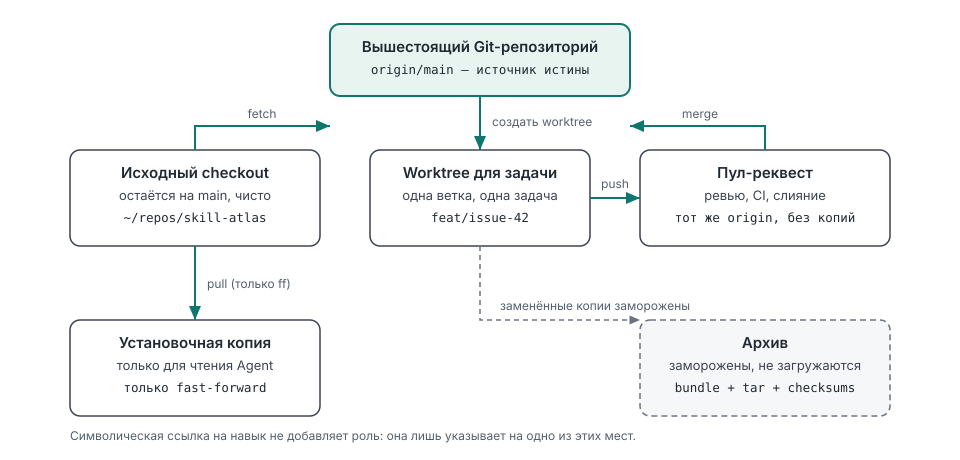
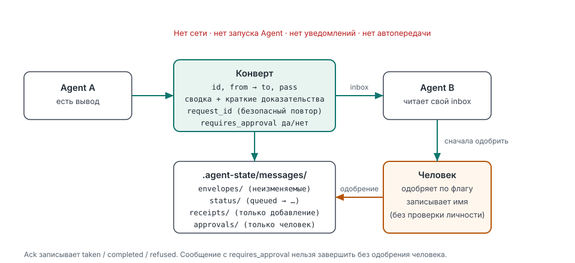
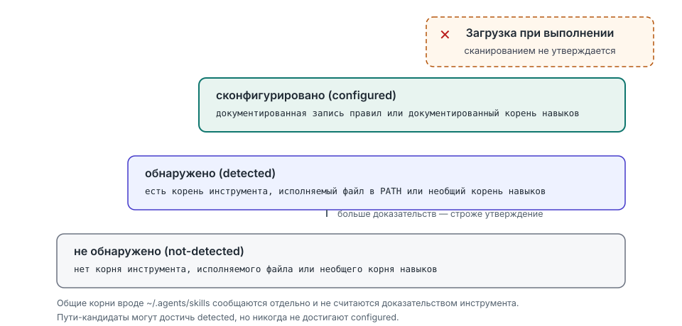

# Skill Atlas

[English](README.md) · [简体中文](README.zh-CN.md) · **Русский**

Сайт: [jorgut.github.io/skill-atlas](https://jorgut.github.io/skill-atlas/)

**Локальный атлас окружения агентов** — что видят ваши агенты, что они загружают и где копии расходятся.

[](https://skills.sh/Jorgut/skill-atlas)
[](https://github.com/Jorgut/skill-atlas)


На вашей машине работают coding-агенты. Skill Atlas показывает, какие из них существуют, откуда они загружают правила и навыки, расходятся ли ваши копии Skill Atlas и где копии проектов разошлись — по умолчанию только для чтения.

Это локальный кроссплатформенный менеджер Agent Skills. Он инвентаризирует установленные навыки, находит дубликаты и символические ссылки, планирует обновления и объединение, ищет альтернативы и конкурентов, рекомендует наборы навыков для продуктов и профессиональных задач, проверяет оркестрацию нескольких навыков, помогает настроить общий контекст проекта и передачу работы между Agent-инструментами, сообщает локальные доказательства только для чтения об установленных coding-агентах и копиях проектов, а также может передавать компактные сообщения о передаче работы между агентами через локальные файлы.

Он поддерживает Codex, OpenCode, Claude Code, общие установки `~/.agents/skills`, кеши плагинов и пользовательские корни навыков. Его рабочий процесс сотрудничества под руководством Agent также охватывает DeepSeek Harness и другие инструменты после проверки их поддержки загрузки инструкций. Планирование только для чтения — режим по умолчанию.

Руководства для начинающих: [中文](docs/GETTING_STARTED.zh-CN.md) | [English](docs/GETTING_STARTED.en.md) | [Русский](docs/GETTING_STARTED.ru.md)

> [!IMPORTANT]
> Копирование папки Skill Atlas в каталог навыков устанавливает только навык. Это **не** регистрирует `/skill-atlas`. Используйте установщик с `--commands`, чтобы зарегистрировать командные адаптеры на платформах, поддерживающих Markdown slash-команды.

## Зачем это нужно

Skill Atlas появился из конкретного сбоя, а не из списка функций.

- **Метка версии скрывала три слитых PR.** Исходный checkout и копия, которую Agent фактически загружал, отстояли друг от друга на три слитых pull request, при этом строка установленной версии всё ещё выглядела актуальной. Теперь `agents scan` сравнивает локальные копии Skill Atlas и устанавливает `version_mismatch`, вместо того чтобы доверять метке.
- **У каждого Agent были свои копии проектов.** Один и тот же проект существовал в нескольких каталогах, и каждый открывался разным инструментом. `projects audit` группирует вероятные дубликаты по нормализованному git remote (подтверждено) или по имени каталога с приведением регистра (вероятно).
- **Документация этих копий разошлась.** `AGENTS.md`, `CLAUDE.md` и файлы состояния различались между копиями, поэтому представление Agent зависело от того, какой checkout он открыл. Аудит хеширует перечисленные документы проекта и сообщает, какие копии различаются, не печатая их содержимое.
- **Настроенные файлы — не загруженные правила.** Наличие файла правил на диске не доказывает, что Agent его прочитал. Лестница доказательств сканирования останавливается на `configured`; загрузка во время выполнения никогда не заявляется, а руководство по сотрудничеству разделяет **сконфигурировано**, **загружено** и **передача проверена** как отдельные утверждения.
- **Передача работы предполагалась, а не подтверждалась квитанцией.** Необязательные локальные сообщения о передаче теперь записывают конверт, квитанции только для добавления и одобрение человека, когда сообщение этого требует. Ничего не отправляется по сети, и ни один Agent не запускается и не получает уведомление.

## Демонстрация за 30 секунд

Сокращённый вывод реальных запусков. Количество инструментов, пути и хеши у вас будут другими.

### Какие Agent-инструменты и копии Skill Atlas существуют

```bash
python3 scripts/skill_atlas.py agents scan
```

```text
## Summary

- tools detected: 12
- tools configured: 4
- skill atlas copies: 2
- version mismatch: false

## Skill Atlas copies

- `~/.cc-switch/skills/skill-atlas`: 0.12.0-beta
- `~/.agents/skills/skill-atlas`: 0.12.0-beta
...
```

Сканирование сообщает только файловые доказательства. `configured` означает, что существуют документированные доказательства конфигурации; это не доказывает, что какой-либо Agent их загрузил. См. [Сканирование локального окружения Agent](docs/agent-environments.md).

### Какие копии проектов разошлись

```bash
python3 scripts/skill_atlas.py projects audit \
  --project ~/repos/widgets --project ~/worktrees/widgets-review
```

```text
## Summary

- projects: 2
- duplicate groups: 1
- divergent docs: 1
...

## Duplicate groups

### `git-remote:github.com/example/widgets` (git-remote)

- `/home/you/repos/widgets`
- `/home/you/worktrees/widgets-review`
- divergent docs:
  - AGENTS.md (2 distinct hashes)
    - `/home/you/worktrees/widgets-review/AGENTS.md` size=47 ... sha256=010df1da4eb3
    - `/home/you/repos/widgets/AGENTS.md` size=41 ... sha256=ade0d2ed5525
- identical docs: none
...
## Recommendations

### `git-remote:github.com/example/widgets`

- canonical candidate: `/home/you/repos/widgets`
- requires user confirmation: true
- suggested actions:
  - keep `/home/you/repos/widgets` as the canonical candidate
  - review divergent AGENTS.md across 2 copies
  - archive the 1 duplicate copy only after user confirmation
  - do not move, merge, delete or rewrite files automatically
```

Хеши доказывают, что документы различаются; они не доказывают, какая копия новее или авторитетнее. Каждая рекомендация — только план. См. [Аудит корней проектов и дублирующейся документации](docs/project-root-audit.md).

### Оставить сообщение для передачи работы (необязательно)

```bash
python3 scripts/skill_atlas.py message send --project . --task issue-28 \
  --from Codex --to "Claude Code" --summary "Review the camera diff" \
  --requires-approval

python3 scripts/skill_atlas.py message inbox --project . --task issue-28 \
  --agent "Claude Code"
```

```text
# Agent message: queued
- id: `msg_...`
- task: issue-28
- from: Codex -> Claude Code
- state: queued
- pass: 1
- approval: pending
...
- note: Local file transport only; the receiving agent has not been notified

# Agent message: ok
- task: issue-28
- agent: Claude Code
- messages: 1
  - `msg_...` Codex -> Claude Code | queued | Review the camera diff
- note: Read-only. Acknowledge with message ack; nothing is sent over the network
```

Ничего не отправляется, и получатель не уведомляется. Сообщение с флагом `--requires-approval` нельзя записать как completed, пока его не одобрит человек. Сообщения — это локальные файлы в `.agent-state/messages/`, и они должны оставаться незакоммиченными. См. [Сообщения о передаче работы между Agent](docs/agent-messaging.md).

Первые две команды только читают локальные файлы. Команда message записывает локальное состояние в `.agent-state/`; ни одна команда не запускает Agent и не обращается к сети.

## Что он делает и от чего отказывается

| Он сообщает и планирует | Он отказывается |
|---|---|
| Какие Agent-инструменты оставляют локальные доказательства и на какие корни правил и навыков они указывают | Отправлять что-либо по сети по умолчанию; публичный поиск выполняется только при явных `--search-mode`, провайдерах и настроенном доступе |
| Где находятся копии Skill Atlas, их версии, псевдонимы и флаг несовпадения | Доверять метке версии или утверждать, что Agent загрузил копию, которую он не загружал |
| Где существуют копии проектов, какие выглядят дубликатами и какие документы проектов различаются | Печатать, хранить или сравнивать содержимое этих документов проекта |
| Инвентаризацию навыков, дубликаты, планы обновления и объединения | Запускать Agent-инструменты, выполнять сторонний код или стартовать другого Agent |
| Рекомендации навыков, моделей и инструментов по общей шкале | Выдумывать бенчмарки, цены, доступность или постоянный рейтинг моделей |
| Упорядоченный многонавыковый процесс и поэтапный план запуска | Автоматически распределять работу или переключать модели без явного разрешения |
| Локальные конверты передачи работы, квитанции и шлюз одобрения человеком | Уведомлять или будить получателя; доставка не заявляется без подтверждения |
| Плановые рекомендации по дубликатам и проектам, требующие подтверждения | Автоматически перемещать, объединять, архивировать, перезаписывать или удалять файлы |
| Пробный запуск установщика для каждой операции копирования и симлинка | Перезаписывать существующие пути или применять без одновременных `--apply` и `--confirm` |
| Локальные файлы состояния в `.agent-state/` и `~/.local/share/skill-atlas` | Читать файлы учётных данных, данные сессий или выносить файлы проекта |

## Принципы в трёх схемах

### Единственный источник истины и три производные копии



Разработка идёт в worktree задачи на отдельной ветке и сливается через pull request. Установочная копия является производной от репозитория и не редактируется на месте, а архивные копии — замороженные доказательства, а не рабочие каталоги. Символическая ссылка на навык не добавляет новую роль; она лишь указывает на одно из этих мест. См. [Установка и схема разработки](docs/development-layout.md).

### Передача работы — это квитанция, а не уведомление



Конверт неизменяем, изменения состояния оставляют квитанции только для добавления, а одобрение — это действие, записываемое человеком. Доставка никогда не заявляется: получатель читает inbox, когда сам решит, и только его собственное подтверждение двигает сообщение дальше. См. [Сообщения о передаче работы между Agent](docs/agent-messaging.md).

### Сканирование останавливается на файловых доказательствах



`not-detected` (не обнаружено) → `detected` (обнаружено) → `configured` (сконфигурировано) — это уровни доказательств локальных файлов, а не состояния выполнения. Общие корни навыков сообщаются отдельно и никогда не считаются доказательством конкретного инструмента, а пути-кандидаты могут достичь `detected`, но никогда `configured`. См. [Сканирование локального окружения Agent](docs/agent-environments.md).

## Установка

### Быстрая установка (рекомендуется)

```bash
npx skills add Jorgut/skill-atlas
```

### Ручная установка

Требования: Git и Python 3.10 или новее.

```bash
git clone https://github.com/Jorgut/skill-atlas.git
cd skill-atlas
```

Сначала просмотрите каждую операцию копирования и симлинка. Эта команда ничего не меняет:

```bash
python3 scripts/skill_atlas.py install --all-platforms --commands
```

После проверки мест назначения явно примените тот же план:

```bash
python3 scripts/skill_atlas.py install --all-platforms --commands --apply --confirm
```

После установки перезапустите установленные Agent-приложения, чтобы они перезагрузили индексы навыков и команд.

Чтобы установить только для выбранных платформ, повторяйте `--platform`:

```bash
python3 scripts/skill_atlas.py install \
  --platform codex \
  --platform opencode \
  --commands
```

## Поведение по платформам

| Платформа | Путь навыка | Командный адаптер | Вызов после установки |
| --- | --- | --- | --- |
| Codex | `~/.codex/skills/skill-atlas` | Не применимо | `$skill-atlas` или обычный текст |
| OpenCode | `~/.config/opencode/skills/skill-atlas` | `~/.config/opencode/commands/skill-atlas.md` | `/skill-atlas` |
| Claude Code | `~/.claude/skills/skill-atlas` | `~/.claude/commands/skill-atlas.md` | `/skill-atlas` |

Установщик хранит одну каноническую копию в `~/.agents/skills/skill-atlas` и связывает с ней каждую выбранную платформу. Это позволяет не поддерживать отдельные физические копии и сохранять ожидаемый каждой платформой путь обнаружения.

Codex не использует встроенный адаптер Markdown slash-команд. В Codex вызывайте установленный навык как `$skill-atlas` или задавайте вопрос обычным текстом, например: `Используй Skill Atlas, чтобы подобрать навыки для проекта автомобильного HMI.`

## Рабочие процессы

| Группа команд | Что делает | Пример |
| --- | --- | --- |
| `install` | Показывает каждое копирование и ссылку, затем применяет только при явном подтверждении | `install --all-platforms --commands` |
| `manage` | Сканирует корни навыков; проверяет статус и свежесть upstream; планирует обновления, дедупликацию и объединение; `manage self` управляет самим Skill Atlas | `manage status --check-upstream` |
| `discover` | Находит похожие публичные навыки, альтернативы, пробелы возможностей или конкурентные референсы | `discover competitors ux-audit` |
| `recommend` | Рекомендует навыки, модели, инструменты, плагины, MCP-серверы и интеграции для задачи | `recommend tool "Rhino and Blender automation"` |
| `orchestrate` | Строит и проверяет упорядоченный многонавыковый процесс; `run` только готовит план | `orchestrate validate "Design an automotive HMI"` |
| `market` | Проверяет свежесть проверенного снимка публичного рынка или сохраняет проверенные результаты | `market status` |
| `monitor` | Планирует регулярное исследование конкурентов и сравнивает завершённые снимки | `monitor add closeout --interval monthly` |
| `agents` | Локальные доказательства только для чтения об Agent-инструментах, корнях правил, корнях навыков и копиях Skill Atlas | `agents scan --project .` |
| `disk` | Аудит диска только для чтения: домашние каталоги Agent, кеши, сессии, плагины, медиа, артефакты сборки и объекты Git, с уровнями риска и плановыми действиями | `disk scan --min-file-mb 100` |
| `projects` | Аудит корней проектов только для чтения: дубликаты копий, разошедшиеся документы, вложенные корни | `projects audit --root ~/Projects --depth 2` |
| `message` | Необязательные локальные конверты передачи работы, квитанции, подтверждения и шлюз одобрения человеком | `message send --task issue-28 --from Codex --to "Claude Code" --summary "Review the camera diff"` |
| `checkpoint` / `handoff` / `resume` | Сохраняет Git-доказательства задачи, фиксирует передачу работы и проверяет её только для чтения при получении | `checkpoint --project . --task issue-28 --agent Codex --summary "..." --next-action "..."` |
| `sync` | Напоминание о синхронизации Git только для чтения: ветка, upstream, ahead/behind, незакоммиченные изменения и предупреждение detached HEAD; никогда не выполняет fetch или push | `sync status --project .` |
| `handoff advise` | Рекомендация передачи с учётом модели только для чтения на основе проверенного локального реестра | `handoff advise --project . --task issue-10` |
| `closeout` | Встроенная инвентаризация проекта только для чтения и проверка оценок Closeout | `closeout audit --project .` |
| `create` | Выбирает документированный способ создания навыка, ничего не создавая | `create plan "Create a skill from GitHub projects" --from github` |
| `feedback` | Обнаруживает, готовит и отправляет очищенный локальный отчёт о проблеме при явном разрешении | `feedback detect --project . --task issue-10` |

По умолчанию всё работает только для чтения. `install`, `manage self update` и `manage self rollback` изменяют файлы только с `--apply --confirm`; `manage update`, `manage sync` и `orchestrate run` всегда создают только планы. Полное дерево команд — в [`SKILL.md`](SKILL.md).

При использовании `/skill-atlas` или `$skill-atlas` остаток строки является запросом. Поддерживаются и запросы обычным текстом:

```text
/skill-atlas recommend the best local and public skills for product animation
$skill-atlas find Rhino and Blender skills, connectors, and missing capabilities
Use Skill Atlas to compare my UX skill with public competitors without replacing mine.
```

### Использование диска (только для чтения по умолчанию)

Работа Agent также оставляет много локальных данных. `disk scan` проверяет известные корни Agent в вашем домашнем каталоге, а также повторяемые каталоги `--root` и один необязательный `--project`:

```bash
python3 scripts/skill_atlas.py disk scan
python3 scripts/skill_atlas.py disk scan \
  --root ~/Documents/ChatGPT --root ~/Documents/Codex --min-file-mb 100
python3 scripts/skill_atlas.py disk scan --project . --format json
# Opt-in cleanup: move selected low/medium-risk candidates to Trash.
python3 scripts/skill_atlas.py disk scan --apply --to-trash --confirm
```

Он сообщает видимый и выделенный размеры, категории, уровни риска (низкий/средний/высокий), крупнейшие файлы по выделенному размеру и список рекомендуемой проверки с плановыми действиями. Выделенный размер (`st_blocks × 512`) — реальное использование диска; видимый размер (`st_size`) — логическая длина файла, которая может быть намного больше у разреженных файлов, поэтому отбор крупнейших файлов, сортировка и итоги по риску используют выделенные байты, а при различии размеры показываются как `выделено (видимо)`. Он читает только метаданные: не содержимое файлов, учётные данные или текст сессий. При обходе он никогда не переходит по символьным ссылкам; по умолчанию он ничего не удаляет, не перемещает, не сжимает и не архивирует. Очистка включается явно: `--apply --to-trash --confirm` (с повторяемым `--risk low|medium`, по умолчанию low) перемещает выбранные кандидаты низкого/среднего риска (прямых потомков) в `~/.Trash` (или `--trash-dir`), никогда не перемещает объекты высокого риска (базы данных, `.git`) или символьные ссылки, не использует `rm -rf` или безвозвратное удаление, а место освобождается только после очистки корзины. Выделенный размер не гарантирует освобождаемого пространства: клоны, снимки и жёсткие ссылки могут делить блоки; базы данных и объекты `.git` нельзя удалять напрямую. Перед действиями проведите проверку; см. [Аудит использования диска](docs/disk-scan.md).

## Начните здесь

| Документ | Что описывает |
| --- | --- |
| [Установка и схема разработки](docs/development-layout.md) | Какая копия является единственным источником истины, где должны находиться worktree, установочные копии и архивы и как сохранять установку честной |
| [Сканирование локального окружения Agent](docs/agent-environments.md) | `agents scan`: каталог инструментов, уровни доказательств, аудит копий, несовпадение версий и что сканирование не может доказать |
| [Аудит корней проектов и дублирующейся документации](docs/project-root-audit.md) | `projects audit`: доказательства дубликатов копий, хеширование документов, вложенные корни и плановые рекомендации |
| [Аудит использования диска](docs/disk-scan.md) | `disk scan`: известные корни, категории и риск, ограничения по видимому размеру, список для проверки и JSON-контракт |
| [Сообщения о передаче работы между Agent](docs/agent-messaging.md) | `message`: состояния конвертов, квитанции, идемпотентность, TTL, шлюз одобрения и необязательный MCP-адаптер |
| [Контекст и передача работы между Agent](docs/cross-agent-collaboration.md) | Настройка общих правил, контекста проекта и уровней доказательств сконфигурировано/загружено/передача проверена |
| [Справочник CLI компонентов](docs/cli-reference.md) | Более низкоуровневые помощники, автоматизированный вывод и детали команд |
| [`SKILL.md`](SKILL.md) | Полный рабочий процесс Agent, правила владения, политика обнаружения, шлюзы безопасности и дерево команд |

Дополнительно: [публичный поиск](docs/external-search.md) · [передача с учётом модели](docs/model-aware-handoff.md) · [план многоагентной разработки](docs/multi-agent-development.md) · [Kimi Code CLI](docs/kimi-code.md) · [цикл обратной связи](docs/feedback-loop.md) · [публичные шаблоны сотрудничества](templates/README.md).

## Контекст и передача работы между Agent

Задайте вопрос обычным текстом:

```text
Use Skill Atlas to inspect how Codex, Claude Code, OpenCode, and DeepSeek Harness load rules, then set up shared project context and handoff.
```

Рабочий процесс под руководством Agent находит точки входа инструкций инструментов, переиспользует правила и состояние проекта и добавляет индекс, когда нескольким проектам нужна маршрутизация. Он фиксирует прогресс и владение файлами, сохраняя историю и резервные копии. Выбор модели и Agent следует требованиям задачи и фактическим возможностям.

Отчёты различают **настроенные файлы**, **подтверждённую загрузку** и **проверенную передачу работы**. Настройка точек входа правил выполняется под руководством Agent; CLI контрольных точек, аудиты только для чтения и необязательная передача сообщений — это отдельные инструменты, а не синхронизация чата в реальном времени.

Перед любыми изменениями начните с команд доказательств только для чтения:

- `agents scan` сообщает локальные доказательства об инструментах и копиях Skill Atlas; он никогда не заявляет загрузку во время выполнения. См. [Сканирование локального окружения Agent](docs/agent-environments.md).
- `projects audit` группирует вероятные копии проектов и сообщает о разошедшихся документах проектов; рекомендации требуют подтверждения. См. [Аудит корней проектов и дублирующейся документации](docs/project-root-audit.md).
- `message` записывает локальный конверт передачи работы с квитанциями и шлюзом одобрения; он никогда не уведомляет и не запускает Agent. См. [Сообщения о передаче работы между Agent](docs/agent-messaging.md).

Публичные отправные точки для общих правил и состояния проекта находятся в [templates/README.md](templates/README.md): общие правила, правила проекта и контекст проекта. Адаптируйте их под проверенные требования инструментов и проектов, не публикуя приватные записи. Agent-инструментам всё ещё нужна собственная конфигурация загрузки инструкций. Руководство также охватывает обнаружение точек входа правил WorkBuddy, приоритет указаний проекта, область аккаунта и проверку во время выполнения для установленной версии.

## Реальный публичный поиск

Единый CLI поддерживает `--search-mode local|web|hybrid`. Существующие команды по умолчанию работают офлайн. Используйте `web` для внешнего поиска без сканирования локальных навыков или `hybrid`, чтобы включить и то и другое:

```bash
python3 scripts/skill_atlas.py discover similar pdf --search-mode web
python3 scripts/skill_atlas.py recommend tool "blender" --search-mode hybrid --format json
python3 scripts/skill_atlas.py market refresh --category pdf --search-mode web
```

Источники по умолчанию — поиск репозиториев GitHub, официальные пути репозитория Skills и официальный MCP Registry. Необязательный `--provider github-code` использует поиск по коду GitHub; `--provider web` использует веб-индекс Brave при настроенном `BRAVE_SEARCH_API_KEY`. Отсутствие доступа, ошибки и ограничения скорости сообщаются явно. Результаты содержат доказательства классификации, отметки времени, URL, дедуплицированное происхождение и прозрачные оценки обнаружения. Это ограниченный поиск, а не исчерпывающий обход веба и не одобрение установки или безопасности. Результаты поиска никогда не обновляют проверенный кеш рынка автоматически.

См. [режимы внешнего поиска, провайдеры, доказательства и проверку](docs/external-search.md).

## Режимы рекомендаций

`recommend` и `orchestrate` принимают один и тот же параметр `--mode`:

| Режим | Поведение | Для чего подходит |
| --- | --- | --- |
| `quick` | Сначала использует установленные навыки и создаёт поиск публичных навыков только для отсутствующих возможностей | Быстрое локальное планирование |
| `balanced` | По умолчанию. Планирует сравнение с тремя публичными кандидатами на каждую возможность, даже если есть локальное совпадение | Обычные продуктовые решения |
| `benchmark` | Расширяет каждую возможность до восьми кандидатов и добавляет углублённые запросы по eval, поддержке, лицензии, совместимости и безопасности | Выбор с высокой ценой ошибки |

Локальные и публичные кандидаты используют одну 100-балльную шкалу: соответствие задаче 30, качество процесса 20, eval-доказательства 15, поддержка 10, источник и лицензия 10, совместимость 10, безопасность 5.

Глубина исследования и сетевой охват независимы: по умолчанию `local` создаёт рабочий список; `--search-mode web|hybrid` выполняет выбранные публичные API. Результат `provisional` — это непроверенный набор кандидатов, а не решение о принятии: Agent должен выполнить эти поиски, проверить источники и оценить кандидатов, прежде чем заявлять о завершённом сравнении. Узкие медиаинструменты требуют явного производственного намерения, а пересекающиеся генераторы презентаций сводятся к одному основному и именованным альтернативам.

Каждый вызов `recommend` и `orchestrate` проверяет проверенный снимок рынка. TTL по умолчанию: семь дней для `quick`, 24 часа для `balanced` и ноль для `benchmark`. `benchmark` и `--refresh` всегда требуют актуального исследования.

## Кеш публичного рынка

Используйте это как лёгкую проверку при запуске; она никогда не обращается к сети:

```bash
python3 scripts/skill_atlas.py market status
```

Когда снимок отсутствует или устарел, выполните обнаружение по категории (без `--search-mode web` создаётся только офлайн-пакет):

```bash
python3 scripts/skill_atlas.py market refresh --category ui-ux --search-mode web
```

Затем активный Agent должен исследовать и проверить кандидатов. Завершённые результаты требуют как минимум одного рыночного источника, одного официального источника или источника на GitHub и одного поддерживаемого источника сообщества:

```json
{
  "summary": "Current reviewed market snapshot",
  "sources": [
    {"name": "skills.sh", "type": "marketplace", "url": "https://skills.sh"},
    {"name": "GitHub", "type": "official-or-github", "url": "https://github.com"},
    {"name": "Community list", "type": "community", "url": "https://github.com/example/awesome-skills"}
  ],
  "candidates": [
    {
      "name": "Candidate",
      "artifact_type": "skill",
      "url": "https://github.com/example/candidate",
      "capabilities": ["design-ux"],
      "roles": ["design", "review"],
      "keywords": ["react", "hmi"],
      "platforms": ["codex", "opencode", "claude"],
      "score": 91
    }
  ]
}
```

Сохраняйте проверенные результаты с `market refresh --results results.json`. Один только сгенерированный пакет остаётся `research-required` и никогда не обновляет отметку свежести. Skill Atlas не устанавливает универсальный стартовый хук, потому что Agent-платформы различаются; платформенная автоматизация может запускать `market status`, а полное исследование остаётся привязанным к TTL или явному запросу.

### Повторное использование проверенных навыков в оркестрации

Метаданные кандидата могут задавать `artifact_type`: `skill` (обратно совместимое значение по умолчанию), `component-library`, `model`, `software-integration` или `domain-reference`. Библиотеки компонентов остаются исполняемыми зависимостями проекта и никогда не копируются в Skill Atlas. Роли кандидатов: `research`, `design`, `discovery`, `planning`, `implementation`, `review` и `verification`. `keywords` не дают рекомендовать узкоспециализированный артефакт для неподходящего продукта. Необязательный `score` от 0 до 100 ранжирует кандидатов, проверенных по общей шкале; в каждой роли побеждает кандидат с наибольшим баллом, не являющийся дубликатом.

Для рабочего процесса React-интерактивности сохраните проверенные записи, например `apple-design`, `find-animation-opportunities`, `improve-animations` и `review-animations` от React Bits, а также проверенный навык реализации, например `motion-dev-animations`. Затем выполните:

```bash
python3 scripts/skill_atlas.py orchestrate plan \
  "Build an interactive React interface with React Bits, motion, accessibility, and performance" \
  --mode balanced
```

Сканируйте локальный репозиторий компонентов только тогда, когда пользователь задал его область:

```bash
python3 scripts/skill_atlas.py orchestrate plan \
  "Build a React liquid glass interface" \
  --component-root /path/to/liquid-glass-design
```

Корнем может быть репозиторий с `component-library.json` или сам манифест. Skill Atlas не обходит всю машину в поисках манифестов пакетов.

Результат хранит три факта отдельно:

- `use_now`: локально установленные и загружаемые навыки
- `reviewed_market_matches`: релевантные типизированные артефакты из сохранённого снимка рынка
- `reviewed_orchestration`: один выбранный артефакт на упорядоченную роль, а пересекающиеся кандидаты перечислены как альтернативы

`installed` означает, что имя навыка найдено локально. `install-required` относится к отсутствующему навыку, а `dependency-required` — к библиотеке компонентов, которую нужно добавить в целевой проект. `refresh-required` означает, что сохранённое исследование выходит за выбранную политику свежести и должно быть проверено снова.

## Регулярные сравнения с конкурентами

Создайте мониторинг один раз:

```bash
python3 scripts/skill_atlas.py monitor add closeout --interval monthly
```

Проверьте, что уже пора запускать, и создайте следующий исследовательский пакет:

```bash
python3 scripts/skill_atlas.py monitor due
python3 scripts/skill_atlas.py monitor run closeout
```

`monitor run` без `--results` записывает снимок `research-required` и остаётся просроченным. Он не заявляет, что веб-исследование было выполнено, и не продвигает расписание. Agent или одобренная автоматизация должны выполнить поиски из пакета, проверить источники, лицензии, поддержку, совместимость и строгую безопасность, затем сохранить:

```json
{
  "summary": "What changed and why it matters",
  "candidates": [
    {"name": "Candidate", "url": "https://github.com/example/candidate"}
  ]
}
```

Зафиксируйте завершённое сравнение и рассчитайте добавления/удаления относительно предыдущего завершённого снимка:

```bash
python3 scripts/skill_atlas.py monitor run closeout --results results.json
python3 scripts/skill_atlas.py monitor history closeout
```

Расписания и снимки по умолчанию хранятся в `~/.local/share/skill-atlas`. Skill Atlas не держит скрытый фоновый процесс. Используйте Codex Automation, OpenCode automation, `cron` или `launchd`, чтобы периодически вызывать `monitor due` и рабочий процесс сравнения с участием Agent.

## Модель безопасности

- Установка — это пробный запуск, пока одновременно не заданы `--apply` и `--confirm`.
- Все конфликты мест назначения обнаруживаются до начала любых изменений.
- Существующие пути никогда не перезаписываются.
- Неудачная установка откатывает ссылки и только что созданную каноническую копию.
- Повтор успешной установки идемпотентен и сообщает `already-installed`.
- Аудиты, дедупликация, сторонние обновления, обнаружение и оркестрация по умолчанию остаются планами.
- Сторонние кандидаты требуют проверки источника, поддержки, лицензии, совместимости, diff и строгого статического анализа безопасности перед рекомендацией установки.
- Пользовательские навыки никогда не заменяются найденными конкурентами.

Чистое статическое сканирование — это шлюз, а не доказательство безопасности стороннего кода. Перед установкой любого внешнего навыка проверьте историю источника и разрешения времени выполнения.

## Обновление Skill Atlas

Skill Atlas не обновляется молча. Рабочий процесс самообновления поддерживает проверенные локальные каталоги релизов и архивы с проверенной контрольной суммой.

Проверьте текущую установку:

```bash
python3 scripts/skill_atlas.py manage self status
```

Просмотрите проверенный кандидат релиза:

```bash
python3 scripts/skill_atlas.py manage self update --source /path/to/reviewed-release
```

Применяйте только после проверки кандидата и заключения о безопасности:

```bash
python3 scripts/skill_atlas.py manage self update \
  --source /path/to/reviewed-release \
  --apply \
  --confirm
```

Просмотрите резервные копии или восстановите одну из них:

```bash
python3 scripts/skill_atlas.py manage self rollback
python3 scripts/skill_atlas.py manage self rollback \
  --backup /path/to/managed-backup \
  --apply \
  --confirm
```

Кандидаты-архивы также требуют `--checksum SHA256`. Загрузка релизов из сети и автоматические обновления из GitHub не входят в эту beta-версию.

Более низкоуровневые команды-помощники и форматы вывода см. в [справочнике CLI компонентов](docs/cli-reference.md).

## Контрольные точки, Closeout и передача с учётом модели

Skill Atlas включает оригинальный пакет Closeout в [`closeout/`](closeout/) вместе с его справочными файлами, набором оценок и инвентаризацией проекта только для чтения. Исходные команды `discover`, `recommend`, `orchestrate`, `market`, `manage` и `monitor` остаются на месте.

Из рабочего каталога проекта:

```bash
python3 /path/to/skill-atlas/scripts/skill_atlas.py checkpoint \
  --project . --task issue-28 --agent Codex \
  --summary "Camera control implemented" \
  --completed "Camera basics" --remaining "Object selection" \
  --next-action "Implement selection and run tests"

python3 /path/to/skill-atlas/scripts/skill_atlas.py handoff \
  --project . --task issue-28 --agent OpenCode \
  --summary "Object selection implemented" \
  --next-action "Verify object transforms" \
  --test-command "npm test" --test-result passed

python3 /path/to/skill-atlas/scripts/skill_atlas.py resume \
  --project . --task issue-28

python3 /path/to/skill-atlas/scripts/skill_atlas.py closeout audit --project .
python3 /path/to/skill-atlas/scripts/skill_atlas.py closeout evals
```

Контрольная точка использует ветку Git, HEAD, количество изменений в рабочем дереве и отпечаток статуса; она сохраняет текущий JSON-снимок задачи и неизменяемую локальную историю в `.agent-state/`. Это состояние локальное и остаётся незакоммиченным. Результаты тестов помечаются как **сообщённые Agent**, а не выполненные независимо. `resume` строго только для чтения и помечает устаревшие Git-доказательства. Результаты checkpoint и handoff теперь включают блок `git.sync` только для чтения и предупреждения об отсутствии upstream, неотправленных коммитах, отставании от remote-tracking-ветки, незакоммиченных изменениях и detached HEAD. Выполните `python3 scripts/skill_atlas.py sync status --project .`, чтобы получить то же напоминание по запросу — на вехе, перед передачей работы или в конце рабочего блока. Фонового таймера нет: эти проверки запускаются только по вашему вызову. Она никогда не выполняет fetch, push, коммит и не переключает ветку; решение о push проверенных коммитов остаётся за вами. Опциональная команда `sync notify` может показывать те же предупреждения из hook или планировщика: `python3 scripts/skill_atlas.py sync notify --project .` (по умолчанию уведомление macOS; `--channel stderr|json`; молчит, когда всё чисто, дедуплицирует и никогда не выполняет push). Ни одна команда не коммитит код, не отправляет состояние, не распределяет работу другому Agent и не переключает модели.

Передача с учётом модели — отдельный советник только для чтения. Он изучает сохранённую контрольную точку, требуемые инструменты и проверенный локальный реестр моделей/Agent, прежде чем рекомендовать преемника; он никогда не переключает модели и не проверяет биллинг, а при отсутствии доказательств возвращает **предварительный шорт-лист**, а не выдуманный рейтинг:

```bash
python3 scripts/skill_atlas.py handoff advise --project . --task issue-10
python3 scripts/skill_atlas.py handoff advise --project . --task issue-10 \
  --task-type code --profiles /path/to/model-agent-profiles.json --format json
```

См. [Передача с учётом модели](docs/model-aware-handoff.md), [пример реестра](examples/model-agent-profiles.example.json) и [обновлённый двухэтапный план разработки](docs/multi-agent-development.md).

### Необязательная общая установка

```bash
python3 scripts/skill_atlas.py install --all-platforms --commands --with-closeout
# After reviewing the plan, explicitly repeat with --apply --confirm.
```

Это создаёт один пакет Skill Atlas и связывает встроенный Closeout со стандартными корнями навыков Codex, OpenCode и Claude Code. Kimi Code CLI нативно сканирует тот же общий каталог `~/.agents/skills`. Если уже существует отдельная установка Closeout, установщик **отказывается от конфликта**, а не удаляет, заменяет или переносит существующую копию. Существующие отдельные установки Closeout остаются нетронутыми.

## Skill Development Kit: необязательный процесс создания

Skill Atlas остаётся основной точкой входа для обнаружения и рекомендаций. Независимый [Skill Development Kit](https://github.com/Jorgut/skill-development-kit) предоставляет три взаимодополняющих способа создания навыков. Селектор методов только для чтения доступен без встраивания или автоматической установки Kit:

```bash
python3 scripts/skill_atlas.py create plan "Create a skill from GitHub projects" --from github
python3 scripts/skill_atlas.py create plan "Extract a skill from research notes" --from notebook \
  --kit-root /path/to/skill-development-kit
```

Доступные методы: `github` (`skill-from-github`), `masters` (`skill-from-masters`) и `notebook` (`skill-from-notebook`). Если источник неясен, Atlas возвращает `plan-only` и запрашивает тип источника. Селектор проверяет наличие выбранного `SKILL.md` в предоставленном локальном checkout Kit; он не создаёт новый навык, не просматривает веб, не устанавливает зависимости и не запускает произвольный внешний код. Более узкое руководство по источникам `search-skill` из Kit может дополнять более широкое публичное обнаружение и проверку безопасности Atlas, но не заменять их.

## Интеграция с Kimi Code CLI

Skill Atlas также поддерживает текущий официальный Kimi Code CLI. Выполните `python3 scripts/skill_atlas.py install --platform kimi --with-closeout`, чтобы просмотреть установку с использованием нативного обнаружения `~/.agents/skills/` в Kimi. Перед применением просмотрите план с `--apply --confirm`. Дублирующая ссылка `~/.kimi-code/skills/` не создаётся.

Вызывайте загруженные навыки через `/skill:skill-atlas` или `/skill:closeout` внутри Kimi Code CLI. При наличии разрешения Kimi также может запускать существующие скрипты checkpoint, handoff и resume только для чтения.

Читайте [поддержку и проверку Kimi Code](docs/kimi-code.md), чтобы узнать о платформенных инструкциях, переопределениях окружения и различии между сконфигурированным, загруженным и проверенным состоянием передачи.

## Цикл обратной связи

Обратная связь по проблемам по умолчанию приватна. Детектор несовпадения контрольных точек готовит очищенный локальный отчёт. Пользователи могут просмотреть предлагаемые GitHub Issues и отправить их после проверки дубликатов при явном разрешении.

```bash
python3 scripts/skill_atlas.py feedback detect --project . --task issue-10
python3 scripts/skill_atlas.py feedback prepare --title "Agent handoff lost state" --summary "Checkpoint mismatch" --category handoff --output /tmp/atlas-feedback.json
python3 scripts/skill_atlas.py feedback submit --file /tmp/atlas-feedback.json
```

После проверки задайте `GITHUB_TOKEN` и добавьте `--confirm` для отправки. Отдельный отчёт только для CI обрабатывает подтверждённые сбои интеграционных тестов в ветке main с минимальными метаданными. Пользовательские установки не отправляют телеметрию и не загружают отчёты автоматически. См. [цикл обратной связи](docs/feedback-loop.md).

## Разработка

Запустите набор тестов:

```bash
python3 -m unittest discover -s tests -v
```

Полный рабочий процесс Agent, правила владения, политику обнаружения, шлюзы безопасности и справку по CLI см. в [`SKILL.md`](SKILL.md).

Рекомендуемую схему локального checkout, worktree, установки и архивирования — а также те же правила для каждого Agent-инструмента — см. в [Установке и схеме разработки](docs/development-layout.md).

## Статус

Сейчас Skill Atlas находится в версии `0.12.0-beta`. До стабильного релиза интерфейсы и платформенные адаптеры могут меняться.
