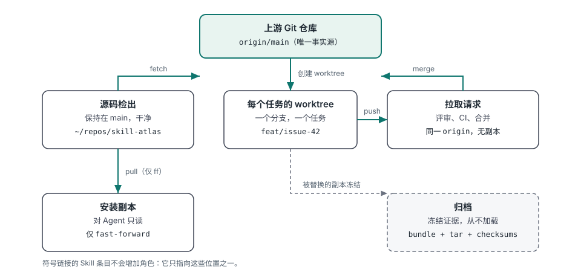
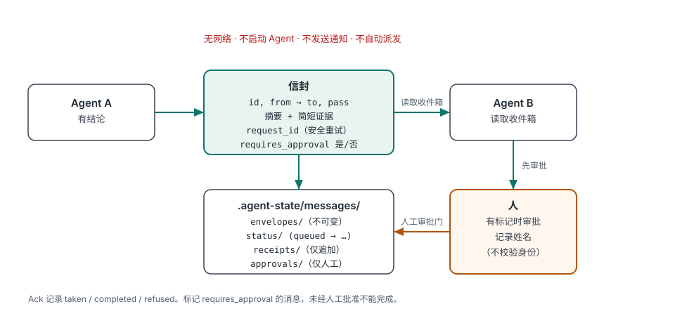
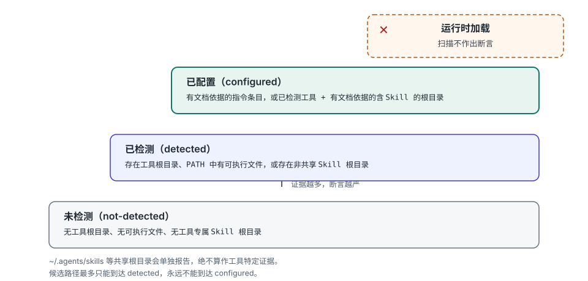

# Skill Atlas

[English](README.md) · **简体中文** · [Русский](README.ru.md)

网站：[jorgut.github.io/skill-atlas](https://jorgut.github.io/skill-atlas/)

**本地 Agent 环境图谱** —— 你的 agent 实际看到什么、加载什么、哪些副本已经分叉。

[](https://skills.sh/Jorgut/skill-atlas)
[](https://github.com/Jorgut/skill-atlas)


你的机器上运行着编码 Agent。Skill Atlas 告诉你哪些 Agent 真实存在、它们从哪里加载规则和 Skill、你的 Skill Atlas 副本是否彼此不一致，以及项目副本在哪里发生了漂移——默认只读。

它是一个本地感知、跨平台的 Agent Skill 管理器。它盘点已安装的 Skill，检测重复与软链接，规划更新与合并，发现替代品与竞品，为产品和专业工作流推荐 Skill 组合，验证多 Skill 编排，指导跨 Agent 工具的共享项目上下文与交接，报告关于已安装编码 Agent 工具和项目副本的只读本地证据，并可通过本地文件传递紧凑的跨 Agent 交接消息。

它支持 Codex、OpenCode、Claude Code、共享 `~/.agents/skills` 安装、插件缓存和自定义 Skill 根目录。在确认各工具的指令加载支持后，其 Agent 引导的协作工作流也覆盖 DeepSeek Harness 及其他工具。只读规划是默认行为。

新手指南：[中文](docs/GETTING_STARTED.zh-CN.md) | [English](docs/GETTING_STARTED.en.md) | [Русский](docs/GETTING_STARTED.ru.md)

> [!IMPORTANT]
> 把 Skill Atlas 文件夹复制到某个 Skill 目录只会安装该 Skill，**不会**注册 `/skill-atlas`。请使用带 `--commands` 的安装器，在支持 Markdown slash 命令的平台上注册命令适配器。

## 为什么需要它

Skill Atlas 源于一次具体故障，而不是一份功能清单。

- **版本标签掩盖了三个已合并的 PR。** 一个源码 checkout 与 Agent 实际加载的副本之间相差三个已合并的 pull request，而安装版本号看起来仍然是最新的。现在 `agents scan` 会比较本地 Skill Atlas 副本并设置 `version_mismatch`，而不是相信标签。
- **各个 Agent 保留了各自的项目副本。** 同一个项目存在于多个目录，分别由不同工具打开。`projects audit` 按规范化 git remote（已确认）或大小写折叠的目录名（可能）对疑似重复副本分组。
- **这些副本的项目文档已经漂移。** 不同副本的 `AGENTS.md`、`CLAUDE.md` 和状态文件并不一致，因此 Agent 的认知取决于它打开的是哪个 checkout。审计会对列出的项目文档计算哈希，报告哪些副本不同，但不打印其内容。
- **已配置文件不等于已加载规则。** 磁盘上存在规则文件，并不能证明 Agent 读取过它。扫描的证据阶梯止步于 `configured`；从不声称运行时加载，协作指南把 **已配置**、**已加载** 和 **交接已验证** 作为彼此独立的断言。
- **交接曾被假定，而不是留下回执。** 可选的本地交接消息现在会记录信封、仅追加的回执，以及消息要求批准时由人记录的批准。不会向网络发送任何内容，也不会启动或通知任何 Agent。

## 30 秒演示

以下输出来自真实运行的裁剪结果。你的工具数量、路径和哈希会不同。

### 存在哪些 Agent 工具与 Skill Atlas 副本

```bash
python3 scripts/skill_atlas.py agents scan
```

```text
## Summary

- tools detected: 12
- tools configured: 4
- skill atlas copies: 2
- version mismatch: false

## Skill Atlas copies

- `~/.cc-switch/skills/skill-atlas`: 0.12.0-beta
- `~/.agents/skills/skill-atlas`: 0.12.0-beta
...
```

扫描只报告文件证据。`configured` 表示存在有文档依据的配置证据；它不能证明任何 Agent 已加载它。参见[本地 Agent 环境扫描](docs/agent-environments.md)。

### 哪些项目副本发生了漂移

```bash
python3 scripts/skill_atlas.py projects audit \
  --project ~/repos/widgets --project ~/worktrees/widgets-review
```

```text
## Summary

- projects: 2
- duplicate groups: 1
- divergent docs: 1
...

## Duplicate groups

### `git-remote:github.com/example/widgets` (git-remote)

- `/home/you/repos/widgets`
- `/home/you/worktrees/widgets-review`
- divergent docs:
  - AGENTS.md (2 distinct hashes)
    - `/home/you/worktrees/widgets-review/AGENTS.md` size=47 ... sha256=010df1da4eb3
    - `/home/you/repos/widgets/AGENTS.md` size=41 ... sha256=ade0d2ed5525
- identical docs: none
...
## Recommendations

### `git-remote:github.com/example/widgets`

- canonical candidate: `/home/you/repos/widgets`
- requires user confirmation: true
- suggested actions:
  - keep `/home/you/repos/widgets` as the canonical candidate
  - review divergent AGENTS.md across 2 copies
  - archive the 1 duplicate copy only after user confirmation
  - do not move, merge, delete or rewrite files automatically
```

哈希证明文档不同；它们不能证明哪个副本更新或更具权威性。每条建议都只是一个计划。参见[项目根与重复文档审计](docs/project-root-audit.md)。

### 留下交接消息（可选）

```bash
python3 scripts/skill_atlas.py message send --project . --task issue-28 \
  --from Codex --to "Claude Code" --summary "Review the camera diff" \
  --requires-approval

python3 scripts/skill_atlas.py message inbox --project . --task issue-28 \
  --agent "Claude Code"
```

```text
# Agent message: queued
- id: `msg_...`
- task: issue-28
- from: Codex -> Claude Code
- state: queued
- pass: 1
- approval: pending
...
- note: Local file transport only; the receiving agent has not been notified

# Agent message: ok
- task: issue-28
- agent: Claude Code
- messages: 1
  - `msg_...` Codex -> Claude Code | queued | Review the camera diff
- note: Read-only. Acknowledge with message ack; nothing is sent over the network
```

不会推送任何内容，接收方也不会收到通知。标记为 `--requires-approval` 的消息，在人批准之前不能记录为已完成。消息是 `.agent-state/messages/` 下的本地文件，必须保持未提交状态。参见[Agent 交接消息](docs/agent-messaging.md)。

前两条命令只读取本地文件。message 命令会在 `.agent-state/` 下写入本地状态；没有命令会启动 Agent 或访问网络。

## 它会做什么，拒绝做什么

| 它会报告和规划 | 它会拒绝 |
|---|---|
| 本地哪些 Agent 工具留下证据，以及它们指向哪些规则与 Skill 根目录 | 默认向网络发送任何内容；公开搜索仅在显式指定 `--search-mode`、提供方和已配置访问权限时运行 |
| Skill Atlas 副本的位置、版本、别名和不一致标志 | 相信版本标签，或声称某个 Agent 加载了它并未加载的副本 |
| 项目副本的位置、哪些看起来重复、哪些项目文档不同 | 打印、存储或比较这些项目文档的内容 |
| Skill 盘点、重复项、更新计划与合并计划 | 执行 Agent 工具、运行第三方代码或启动另一个 Agent |
| 按统一评分标准给出 Skill、模型和工具推荐 | 编造基准结果、价格、可用性或永久模型排名 |
| 有序的多 Skill 工作流与分阶段运行计划 | 自动派发工作，或未经明确授权切换模型 |
| 本地交接信封、回执和人工审批门 | 通知或唤醒接收方；没有确认就不声称已送达 |
| 仅计划、需要确认的重复项与项目建议 | 自动移动、合并、归档、重写或删除文件 |
| 安装器对每个复制与软链接操作的预演 | 覆盖已有路径，或在未同时提供 `--apply` 和 `--confirm` 时应用 |
| `.agent-state/` 与 `~/.local/share/skill-atlas` 下的本地状态文件 | 读取凭据文件、会话数据，或外泄项目文件 |

## 三张图看懂原则

### 一个唯一事实源，三类派生副本



开发在任务 worktree 的分支上进行，并通过 pull request 合并。安装副本从仓库派生，不就地编辑；归档副本是冻结的证据，而不是工作目录。软链接的 Skill 条目不会增加新角色，它只指向这些位置之一。参见[安装与开发布局](docs/development-layout.md)。

### 交接是回执，不是通知



信封不可变，状态变更会留下仅追加的回执，批准是人记录的动作。从不声称送达：接收方在自己选择时读取收件箱，只有它自己的确认才会让消息向前推进。参见[Agent 交接消息](docs/agent-messaging.md)。

### 扫描止步于文件证据



`not-detected`（未检测）→ `detected`（已检测）→ `configured`（已配置）是本地文件证据的等级（证据等级），不是运行时状态。共享 Skill 根目录会单独报告，绝不算作工具特定证据；候选路径最多只能到达 `detected`，永远不能到达 `configured`。参见[本地 Agent 环境扫描](docs/agent-environments.md)。

## 安装

### 快速安装（推荐）

```bash
npx skills add Jorgut/skill-atlas
```

### 手动安装

要求：Git 和 Python 3.10 或更高版本。

```bash
git clone https://github.com/Jorgut/skill-atlas.git
cd skill-atlas
```

先预览每个复制和软链接操作。此命令不会更改任何内容：

```bash
python3 scripts/skill_atlas.py install --all-platforms --commands
```

查看目标位置后，显式应用同一计划：

```bash
python3 scripts/skill_atlas.py install --all-platforms --commands --apply --confirm
```

安装后重启已安装的 Agent 应用，使它们重新加载 Skill 与命令索引。

如果只安装选定平台，请重复 `--platform`：

```bash
python3 scripts/skill_atlas.py install \
  --platform codex \
  --platform opencode \
  --commands
```

## 平台行为

| 平台 | Skill 路径 | 命令适配器 | 安装后如何调用 |
| --- | --- | --- | --- |
| Codex | `~/.codex/skills/skill-atlas` | 不适用 | `$skill-atlas` 或自然语言 |
| OpenCode | `~/.config/opencode/skills/skill-atlas` | `~/.config/opencode/commands/skill-atlas.md` | `/skill-atlas` |
| Claude Code | `~/.claude/skills/skill-atlas` | `~/.claude/commands/skill-atlas.md` | `/skill-atlas` |

安装器在 `~/.agents/skills/skill-atlas` 保留一份规范副本，并把每个选定平台链接到它。这样既能避免维护多份物理副本，又能保留各平台期望的发现路径。

Codex 不使用捆绑的 Markdown slash 命令适配器。在 Codex 中，以 `$skill-atlas` 调用已安装的 Skill，或用自然语言提问，例如：`使用 Skill Atlas 为汽车 HMI 项目推荐 Skill。`

## 工作流

| 命令组 | 作用 | 示例 |
| --- | --- | --- |
| `install` | 预览每个复制和链接，然后仅在明确确认后应用 | `install --all-platforms --commands` |
| `manage` | 扫描 Skill 根目录；检查状态与上游新鲜度；规划更新、去重和合并；`manage self` 管理 Skill Atlas 自身 | `manage status --check-upstream` |
| `discover` | 查找相似的公开 Skill、替代品、能力缺口或竞品参考 | `discover competitors ux-audit` |
| `recommend` | 为任务推荐 Skill、模型、工具、插件、MCP 服务器与集成 | `recommend tool "Rhino and Blender automation"` |
| `orchestrate` | 构建并验证有序的多 Skill 工作流；`run` 只生成计划 | `orchestrate validate "Design an automotive HMI"` |
| `market` | 检查已审核公开市场快照的新鲜度，或保存已审核结果 | `market status` |
| `monitor` | 安排定期竞品研究，并比较已完成快照 | `monitor add closeout --interval monthly` |
| `agents` | 面向 Agent 工具、规则根目录、Skill 根目录和 Skill Atlas 副本的只读本地证据 | `agents scan --project .` |
| `disk` | 只读磁盘审计：Agent 主目录、缓存、会话、插件、媒体、构建产物和 Git 对象，包含风险等级与仅计划操作 | `disk scan --min-file-mb 100` |
| `projects` | 只读项目根审计：重复副本、分叉文档、嵌套根目录 | `projects audit --root ~/Projects --depth 2` |
| `message` | 可选的本地交接信封、回执、确认和人工审批门 | `message send --task issue-28 --from Codex --to "Claude Code" --summary "Review the camera diff"` |
| `checkpoint` / `handoff` / `resume` | 保存任务范围的 Git 证据、记录交接，并在接收时只读验证 | `checkpoint --project . --task issue-28 --agent Codex --summary "..." --next-action "..."` |
| `sync` | 只读 Git 同步提醒：分支、上游、领先/落后、未提交变更和 detached HEAD 警告；从不 fetch 或 push | `sync status --project .` |
| `handoff advise` | 基于已审核本地注册表的只读模型感知交接建议 | `handoff advise --project . --task issue-10` |
| `closeout` | 捆绑的只读项目清单与 Closeout 评估验证 | `closeout audit --project .` |
| `create` | 选择一种有文档依据的 Skill 创建方法，而不实际创建 | `create plan "Create a skill from GitHub projects" --from github` |
| `feedback` | 检测、准备并在明确授权后提交脱敏的本地问题报告 | `feedback detect --project . --task issue-10` |

默认只读。`install`、`manage self update` 和 `manage self rollback` 仅在带 `--apply --confirm` 时修改文件；`manage update`、`manage sync` 和 `orchestrate run` 始终只生成计划。完整命令树见 [`SKILL.md`](SKILL.md)。

使用 `/skill-atlas` 或 `$skill-atlas` 时，该行剩余内容就是请求。也支持自然语言请求：

```text
/skill-atlas recommend the best local and public skills for product animation
$skill-atlas find Rhino and Blender skills, connectors, and missing capabilities
Use Skill Atlas to compare my UX skill with public competitors without replacing mine.
```

### 磁盘占用（默认只读）

Agent 工作也会在本地留下大量数据。`disk scan` 会审计你主目录下的已知 Agent 根目录，以及可重复提供的 `--root` 目录和一个可选的 `--project`：

```bash
python3 scripts/skill_atlas.py disk scan
python3 scripts/skill_atlas.py disk scan \
  --root ~/Documents/ChatGPT --root ~/Documents/Codex --min-file-mb 100
python3 scripts/skill_atlas.py disk scan --project . --format json
# Opt-in cleanup: move selected low/medium-risk candidates to Trash.
python3 scripts/skill_atlas.py disk scan --apply --to-trash --confirm
```

它会报告表观大小与分配大小、类别、风险等级（低/中/高）、按分配大小排列的最大文件，以及带仅计划操作的建议复查列表。分配大小（`st_blocks × 512`）是真实磁盘占用；表观大小（`st_size`）是逻辑文件长度，对稀疏文件可能大得多，因此最大文件筛选、排序和风险总计使用分配字节，两者不同时以 `分配 (表观)` 显示。它只读取元数据：不读取文件内容、凭据或会话文本。它在遍历时从不跟随软链接；默认不删除、移动、压缩或归档任何内容。清理需要显式启用：`--apply --to-trash --confirm`（配合可重复的 `--risk low|medium`，默认 low）会把选中的低/中风险直接子项移入 `~/.Trash`（或 `--trash-dir`），永远不会移动高风险数据库、`.git` 对象或软链接，也从不使用 `rm -rf` 或永久删除；只有清空回收站后才会真正释放空间。分配大小并不保证可回收空间，因为克隆、快照和硬链接可能共享数据块；数据库或 `.git` 对象不得直接删除。行动前请先复查；参见[磁盘占用审计](docs/disk-scan.md)。

## 从这里开始

| 文档 | 内容 |
| --- | --- |
| [安装与开发布局](docs/development-layout.md) | 哪份副本是唯一事实源，worktree、安装副本和归档应放在哪里，以及如何让安装保持诚实 |
| [本地 Agent 环境扫描](docs/agent-environments.md) | `agents scan`：工具目录、证据等级、副本审计、版本不一致，以及扫描无法证明什么 |
| [项目根与重复文档审计](docs/project-root-audit.md) | `projects audit`：重复副本证据、文档哈希、嵌套根目录和仅计划建议 |
| [磁盘占用审计](docs/disk-scan.md) | `disk scan`：已知根目录、类别与风险、表观大小限制、建议复查和 JSON 契约 |
| [Agent 交接消息](docs/agent-messaging.md) | `message`：信封状态、回执、幂等、TTL、人工审批门和可选的 MCP 适配器 |
| [跨 Agent 上下文与交接](docs/cross-agent-collaboration.md) | 配置共享规则、项目级上下文，以及已配置/已加载/交接已验证的证据等级 |
| [组件 CLI 参考](docs/cli-reference.md) | 更底层的辅助工具、自动化输出和命令级细节 |
| [`SKILL.md`](SKILL.md) | 完整的 Agent 工作流、所有权规则、发现策略、安全门和命令树 |

更多：[公开搜索](docs/external-search.md) · [模型感知交接](docs/model-aware-handoff.md) · [多 Agent 开发计划](docs/multi-agent-development.md) · [Kimi Code CLI](docs/kimi-code.md) · [反馈回路](docs/feedback-loop.md) · [公开协作模板](templates/README.md)。

## 跨 Agent 上下文与交接

用自然语言提问：

```text
Use Skill Atlas to inspect how Codex, Claude Code, OpenCode, and DeepSeek Harness load rules, then set up shared project context and handoff.
```

Agent 引导的工作流会发现工具指令条目，复用项目规则和状态，并在多个项目需要路由时添加索引。它记录进展和文件所有权，同时保留历史与备份。模型和 Agent 的选择遵循任务需求和实际能力。

报告区分 **已配置文件**、**已验证加载** 和 **已验证交接**。规则入口配置由 Agent 引导；checkpoint CLI、只读审计和可选的 message 传输是彼此独立的工具，不是实时聊天同步。

在改动任何内容之前，只读证据命令是起点：

- `agents scan` 报告本地工具和 Skill Atlas 副本证据；它从不声称运行时加载。参见[本地 Agent 环境扫描](docs/agent-environments.md)。
- `projects audit` 对疑似项目副本分组，并报告分叉的项目文档；建议需要确认。参见[项目根与重复文档审计](docs/project-root-audit.md)。
- `message` 记录带回执和人工审批门的本地交接信封；它从不通知或启动 Agent。参见[Agent 交接消息](docs/agent-messaging.md)。

共享规则和项目状态的公开起点在 [templates/README.md](templates/README.md)：通用规则、项目规则和项目上下文。请按已验证的工具/项目要求调整，不要发布私有记录。Agent 工具仍需要各自的指令加载配置。该指南还覆盖 WorkBuddy 规则入口发现、项目指引优先级、账户范围和针对已安装版本的运行时验证。

## 真实的公开搜索

统一 CLI 支持 `--search-mode local|web|hybrid`。现有命令默认离线。使用 `web` 可在不扫描本地 Skill 的情况下执行外部搜索，使用 `hybrid` 可同时包含两者：

```bash
python3 scripts/skill_atlas.py discover similar pdf --search-mode web
python3 scripts/skill_atlas.py recommend tool "blender" --search-mode hybrid --format json
python3 scripts/skill_atlas.py market refresh --category pdf --search-mode web
```

默认外部来源是 GitHub 仓库搜索、官方 Skills 仓库路径和官方 MCP Registry。可选的 `--provider github-code` 使用 GitHub 代码搜索；`--provider web` 在配置 `BRAVE_SEARCH_API_KEY` 后使用 Brave 网页索引。缺失访问权限、失败和速率限制都会被明确报告。结果包含分类证据、时间戳、URL、去重后的来源和透明的发现评分。这是有边界的搜索，不是穷尽式网页抓取，也不是安装或安全批准。搜索结果永远不会自动刷新已审核的市场缓存。

参见[外部搜索模式、提供方、证据与审查](docs/external-search.md)。

## 推荐模式

`recommend` 和 `orchestrate` 接受相同的 `--mode` 选项：

| 模式 | 行为 | 适合 |
| --- | --- | --- |
| `quick` | 优先使用已安装的 Skill，只为缺失能力创建公开 Skill 搜索 | 快速本地规划 |
| `balanced` | 默认。即使存在本地匹配，也为每项能力规划与三个公开候选的对比 | 常规产品决策 |
| `benchmark` | 把每项能力扩展到八个候选，并增加更深入的 eval、维护、许可证、兼容性和安全查询 | 高风险选型 |

本地和公开候选使用同一套 100 分标准：任务匹配 30、工作流质量 20、eval 证据 15、维护 10、来源与许可证 10、兼容性 10、安全 5。

研究深度与网络范围相互独立：默认的 `local` 只生成工作清单；`--search-mode web|hybrid` 会执行选定的公开 API。`provisional` 结果只是未经验证的候选集，不是采纳决定：Agent 必须执行这些搜索、检查来源并给候选评分，然后才能声称对比已完成。窄域媒体工具需要明确的生产意图，重叠的演示文稿生成器会被缩减为一个主选加具名备选。

每次 `recommend` 和 `orchestrate` 调用都会检查已审核的市场快照。默认 TTL 为：`quick` 七天，`balanced` 24 小时，`benchmark` 为零。`benchmark` 和 `--refresh` 始终要求最新研究。

## 公开市场缓存

把它作为轻量启动检查；它从不访问网络：

```bash
python3 scripts/skill_atlas.py market status
```

当快照缺失或过期时，执行按类别划分的发现（省略 `--search-mode web` 只生成离线研究包）：

```bash
python3 scripts/skill_atlas.py market refresh --category ui-ux --search-mode web
```

当前 Agent 随后必须研究和审查候选。完成的结果至少需要一个市场来源、一个官方或 GitHub 来源，以及一个持续维护的社区来源：

```json
{
  "summary": "Current reviewed market snapshot",
  "sources": [
    {"name": "skills.sh", "type": "marketplace", "url": "https://skills.sh"},
    {"name": "GitHub", "type": "official-or-github", "url": "https://github.com"},
    {"name": "Community list", "type": "community", "url": "https://github.com/example/awesome-skills"}
  ],
  "candidates": [
    {
      "name": "Candidate",
      "artifact_type": "skill",
      "url": "https://github.com/example/candidate",
      "capabilities": ["design-ux"],
      "roles": ["design", "review"],
      "keywords": ["react", "hmi"],
      "platforms": ["codex", "opencode", "claude"],
      "score": 91
    }
  ]
}
```

用 `market refresh --results results.json` 保存已审核结果。仅生成研究包会保持 `research-required`，且永不更新新鲜度时间戳。Skill Atlas 不安装通用启动钩子，因为 Agent 平台各不相同；平台自动化可以运行 `market status`，而完整研究仍由 TTL 或显式请求驱动。

### 在编排中复用已审核的 Skill

候选元数据可以指定 `artifact_type`：`skill`（向后兼容的默认值）、`component-library`、`model`、`software-integration` 或 `domain-reference`。组件库仍是可执行的项目依赖，永远不会被复制到 Skill Atlas 中。候选角色使用 `research`、`design`、`discovery`、`planning`、`implementation`、`review` 和 `verification`。`keywords` 可防止把通用能力匹配到错误产品的领域专用工件。可选的 `score`（0 到 100）按统一标准为已审核候选排序；每个角色由得分最高且不重复的候选胜出。

对于 React 交互工作流，保存已审核条目，例如 React Bits 的 `apple-design`、`find-animation-opportunities`、`improve-animations` 和 `review-animations`，再加上一个已审核的实现类 Skill，例如 `motion-dev-animations`。然后运行：

```bash
python3 scripts/skill_atlas.py orchestrate plan \
  "Build an interactive React interface with React Bits, motion, accessibility, and performance" \
  --mode balanced
```

仅当用户提供范围时，才扫描本地组件仓库：

```bash
python3 scripts/skill_atlas.py orchestrate plan \
  "Build a React liquid glass interface" \
  --component-root /path/to/liquid-glass-design
```

根目录可以是包含 `component-library.json` 的仓库，也可以直接是该清单文件。Skill Atlas 不会爬取整台机器来寻找包清单。

结果把三个事实分开保留：

- `use_now`：本地已安装且可加载的 Skill
- `reviewed_market_matches`：来自已保存市场快照的相关类型化工件
- `reviewed_orchestration`：每个有序角色选择一个工件，重叠候选列为备选

`installed` 表示在本地找到了某个 Skill 名称。`install-required` 适用于缺失的 Skill，`dependency-required` 适用于必须添加到目标项目的组件库。`refresh-required` 表示已保存的研究超出所选新鲜度策略，必须重新检查。

## 定期竞品对比

创建一次监控：

```bash
python3 scripts/skill_atlas.py monitor add closeout --interval monthly
```

检查哪些已到期并生成下一份研究包：

```bash
python3 scripts/skill_atlas.py monitor due
python3 scripts/skill_atlas.py monitor run closeout
```

不带 `--results` 的 `monitor run` 只记录一个 `research-required` 快照，并保持到期状态。它不声称已进行网页研究，也不推进日程。Agent 或经批准的自动化应执行研究包中的搜索、来源检查、许可证审查、维护审查、兼容性检查和严格安全审查，然后保存：

```json
{
  "summary": "What changed and why it matters",
  "candidates": [
    {"name": "Candidate", "url": "https://github.com/example/candidate"}
  ]
}
```

记录完成的对比，并与上一份已完成快照计算新增/移除：

```bash
python3 scripts/skill_atlas.py monitor run closeout --results results.json
python3 scripts/skill_atlas.py monitor history closeout
```

日程和快照默认保存在 `~/.local/share/skill-atlas`。Skill Atlas 不保留隐藏的后台进程。使用 Codex Automation、OpenCode automation、`cron` 或 `launchd` 定期调用 `monitor due` 和 Agent 辅助的对比工作流。

## 安全模型

- 除非同时提供 `--apply` 和 `--confirm`，安装只是预演。
- 所有目标冲突都会在任何变更开始前检测出来。
- 已有路径永远不会被覆盖。
- 安装失败会回滚链接和新创建的规范副本。
- 重复成功的安装是幂等的，并报告 `already-installed`。
- 审计、去重、第三方更新、发现和编排默认保持为计划。
- 第三方候选在推荐安装前需要来源、维护、许可证、兼容性、diff 和严格静态安全审查。
- 用户自研的 Skill 永远不会被发现的竞品替换。

干净的静态扫描是一道门，而不是第三方代码安全的证明。安装任何外部 Skill 前，请审查来源历史和运行时权限。

## 更新 Skill Atlas

Skill Atlas 不会悄悄更新自己。自更新工作流支持经过审核的本地发布目录和校验和验证的归档。

检查当前安装：

```bash
python3 scripts/skill_atlas.py manage self status
```

预览一个已审核的发布候选：

```bash
python3 scripts/skill_atlas.py manage self update --source /path/to/reviewed-release
```

只有在审查候选和安全结论后才应用：

```bash
python3 scripts/skill_atlas.py manage self update \
  --source /path/to/reviewed-release \
  --apply \
  --confirm
```

列出备份或恢复其中一个：

```bash
python3 scripts/skill_atlas.py manage self rollback
python3 scripts/skill_atlas.py manage self rollback \
  --backup /path/to/managed-backup \
  --apply \
  --confirm
```

归档候选还需要 `--checksum SHA256`。网络发布获取和无人值守的 GitHub 更新不属于本次 beta 发布。

更底层的辅助命令和输出格式，参见[组件 CLI 参考](docs/cli-reference.md)。

## 检查点、Closeout 与模型感知交接

Skill Atlas 在 [`closeout/`](closeout/) 捆绑了原始 Closeout 包，包括参考文件、评估套件和只读项目清单。原有的 `discover`、`recommend`、`orchestrate`、`market`、`manage` 和 `monitor` 命令保持不变。

在项目工作目录中：

```bash
python3 /path/to/skill-atlas/scripts/skill_atlas.py checkpoint \
  --project . --task issue-28 --agent Codex \
  --summary "Camera control implemented" \
  --completed "Camera basics" --remaining "Object selection" \
  --next-action "Implement selection and run tests"

python3 /path/to/skill-atlas/scripts/skill_atlas.py handoff \
  --project . --task issue-28 --agent OpenCode \
  --summary "Object selection implemented" \
  --next-action "Verify object transforms" \
  --test-command "npm test" --test-result passed

python3 /path/to/skill-atlas/scripts/skill_atlas.py resume \
  --project . --task issue-28

python3 /path/to/skill-atlas/scripts/skill_atlas.py closeout audit --project .
python3 /path/to/skill-atlas/scripts/skill_atlas.py closeout evals
```

检查点使用 Git 分支、HEAD、工作区变更数量和状态指纹；它在 `.agent-state/` 下保存任务范围的当前 JSON 快照以及不可变的本地历史。该状态是本地的，保持未提交。测试结果标记为 **Agent 报告**，而不是独立执行。`resume` 严格只读，并会标记过期的 Git 证据。检查点和交接结果现在包含只读的 `git.sync` 块，以及无上游、未推送提交、落后于远端跟踪分支、未提交变更或 detached HEAD 的警告。可随时运行 `python3 scripts/skill_atlas.py sync status --project .` 获取同样的提醒——在里程碑、交接前或一个工作块结束时。它不是后台计时器：只有你主动调用时才运行。它从不 fetch、push、提交或切换分支；是否推送已审核的提交由你决定。可选的 `sync notify` 命令可以从 hook 或调度器中获取同样的提醒：`python3 scripts/skill_atlas.py sync notify --project .`（默认 macOS 通知；可用 `--channel stderr|json`；干净时静默、去重、从不推送）。没有命令会提交代码、推送状态、派发另一个 Agent 或切换模型。

模型感知交接是一个独立的只读顾问。它会检查已保存的检查点、所需工具和已审核的本地模型/Agent 注册表，然后推荐继任者；它从不切换模型或检查计费，并在证据缺失时返回 **暂定候选名单**，而不是编造的排行榜：

```bash
python3 scripts/skill_atlas.py handoff advise --project . --task issue-10
python3 scripts/skill_atlas.py handoff advise --project . --task issue-10 \
  --task-type code --profiles /path/to/model-agent-profiles.json --format json
```

参见[模型感知交接](docs/model-aware-handoff.md)、[示例注册表](examples/model-agent-profiles.example.json)和[更新的两阶段开发计划](docs/multi-agent-development.md)。

### 可选的共享安装

```bash
python3 scripts/skill_atlas.py install --all-platforms --commands --with-closeout
# After reviewing the plan, explicitly repeat with --apply --confirm.
```

这会创建一个 Skill Atlas 包，并把捆绑的 Closeout 链接到标准 Codex、OpenCode 和 Claude Code Skill 根目录。Kimi Code CLI 原生扫描同一共享 `~/.agents/skills` 目录。如果已存在独立的 Closeout 安装，安装会 **拒绝冲突**，而不是删除、替换或迁移现有副本。现有独立 Closeout 安装保持不变。

## Skill Development Kit：可选的创建流程

Skill Atlas 仍是主要的发现和推荐入口。独立的 [Skill Development Kit](https://github.com/Jorgut/skill-development-kit) 提供三种互补的 Skill 创建方法。无需捆绑或自动安装该 Kit，即可使用只读的方法选择器：

```bash
python3 scripts/skill_atlas.py create plan "Create a skill from GitHub projects" --from github
python3 scripts/skill_atlas.py create plan "Extract a skill from research notes" --from notebook \
  --kit-root /path/to/skill-development-kit
```

可用方法为 `github`（`skill-from-github`）、`masters`（`skill-from-masters`）和 `notebook`（`skill-from-notebook`）。如果来源不明确，Atlas 会返回 `plan-only` 并询问来源类型。选择器会检查所提供的本地 Kit checkout 中是否存在所选 `SKILL.md`；它不会创建新 Skill、浏览网页、安装依赖或运行任意外部代码。Kit 更窄的 `search-skill` 来源指南可以补充 Atlas 更广泛的公开发现和安全审查，但不得取代它。

## Kimi Code CLI 集成

Skill Atlas 也支持当前的官方 Kimi Code CLI。运行 `python3 scripts/skill_atlas.py install --platform kimi --with-closeout`，可预览一次使用 Kimi 原生 `~/.agents/skills/` 发现的安装。应用前先用 `--apply --confirm` 审查计划。不会创建重复的 `~/.kimi-code/skills/` 链接。

在 Kimi Code CLI 内用 `/skill:skill-atlas` 或 `/skill:closeout` 调用已加载的 Skill。经授权后，Kimi 也可以运行现有的项目 checkpoint、handoff 和只读 resume 脚本。

阅读 [Kimi Code 支持与验证](docs/kimi-code.md)，了解平台说明、环境变量覆盖，以及已配置、已加载和交接已验证之间的区别。

## 反馈回路

问题反馈默认私有。检查点不匹配检测器会准备一份脱敏的本地报告。用户可以预览拟提交的 GitHub Issue，并在去重检查后经明确授权提交。

```bash
python3 scripts/skill_atlas.py feedback detect --project . --task issue-10
python3 scripts/skill_atlas.py feedback prepare --title "Agent handoff lost state" --summary "Checkpoint mismatch" --category handoff --output /tmp/atlas-feedback.json
python3 scripts/skill_atlas.py feedback submit --file /tmp/atlas-feedback.json
```

审查后，设置 `GITHUB_TOKEN` 并添加 `--confirm` 以提交。一个独立的仅 CI 报告器会处理主分支上已确认的集成测试失败，只收集最少元数据。社区安装不发送遥测，也不会自动上传报告。参见[反馈回路](docs/feedback-loop.md)。

## 开发

运行测试套件：

```bash
python3 -m unittest discover -s tests -v
```

完整的 Agent 工作流、所有权规则、发现策略、安全门和 CLI 参考，参见 [`SKILL.md`](SKILL.md)。

关于推荐的本地 checkout、worktree、安装和归档布局——以及适用于每个 Agent 工具的同一套规则——参见[安装与开发布局](docs/development-layout.md)。

## 状态

Skill Atlas 当前为 `0.12.0-beta`。在稳定版发布前，接口和平台适配器可能发生变化。
