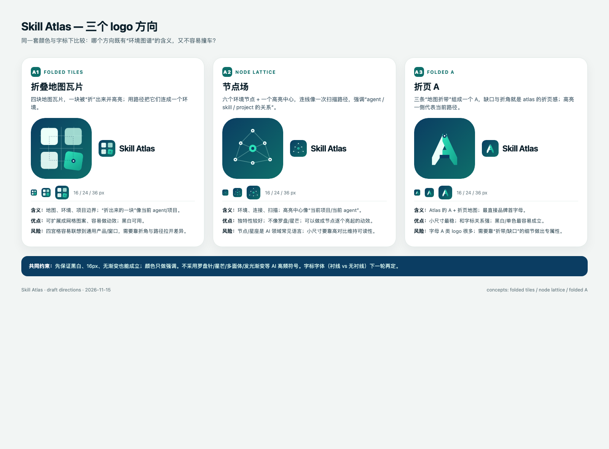

# Skill Atlas brand exploration

Draft logo directions, not a final identity. The current comparison is a
decision aid: three systems evaluated for distinctiveness, small-size
legibility, meaning and collision risk.

## Files

- `concepts/A1-folded-tiles.svg` — folded map tiles; good for patterns/backgrounds.
- `concepts/A2-node-lattice.svg` — node lattice; good for scanning/motion states.
- `concepts/A3-folded-a.svg` — folded A; strongest primary-mark candidate so far.
- `concepts/compare.html` — local comparison board.
- `concepts/comparison.png` — rendered board.

## Status

This is a **working draft**. No mark here is final, registered or approved for
external use. A separate trademark policy will be added with the chosen mark.
The reference images used during exploration are not committed here.

## Direction notes

- A1: atlas/map tiles; risk of generic four-square/window association at small sizes.
- A2: environment nodes and a scan path; distinctive but can read as generic AI network.
- A3: atlas "A" + folded map strips; best small-size behavior and strongest link to the name.

The wordmark, final optical corrections, mono/light/dark exports and any
trademark search are pending.
