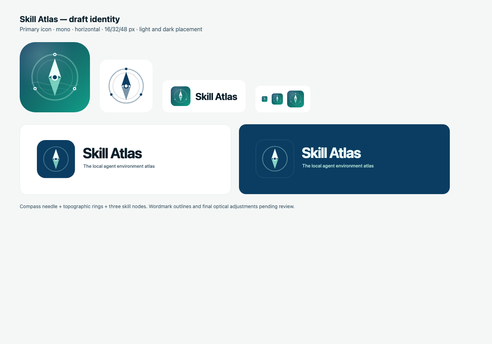

# Skill Atlas brand assets

Draft identity: a compass/atlas mark for a local-first agent environment atlas.
The mark is a compass needle inside topographic rings, with three nodes for the
skills, projects and agents in the environment.

## Files

| File | Use |
|---|---|
| `skill-atlas-icon.svg` | Primary app/social icon (1024, rounded square) |
| `skill-atlas-icon-mono.svg` | One-color icon for light backgrounds/print |
| `skill-atlas-logo.svg` | Horizontal icon + wordmark + tagline (light background) |
| `skill-atlas-logo-light.svg` | Horizontal lockup for dark backgrounds |
| `skill-atlas-icon.png` | 1024 px PNG export of the primary icon |
| `preview.png` | Draft identity contact sheet |

## Colors

- Deep navy: `#0B3D62`
- Teal: `#0E6F6A`
- Mint: `#13A08B`
- Ice: `#ECFFF9`
- Ink: `#0B1F2A`

## Usage

- Keep clear space of at least the icon's ring width around the mark.
- Use the primary icon on dark or photographic backgrounds; use the mono icon on
  light solid backgrounds.
- Do not stretch, recolor, rotate, add effects, or place text inside the icon.
- Do not use the mark as a generic "AI" badge; it identifies Skill Atlas only.

## License and trademark

Code is MIT. The name and logo are covered by [TRADEMARK.md](../TRADEMARK.md),
not by the MIT License. Forks must use a different name and logo.

This is an initial draft identity; wordmark outlines and final optical adjustments
are pending review.
